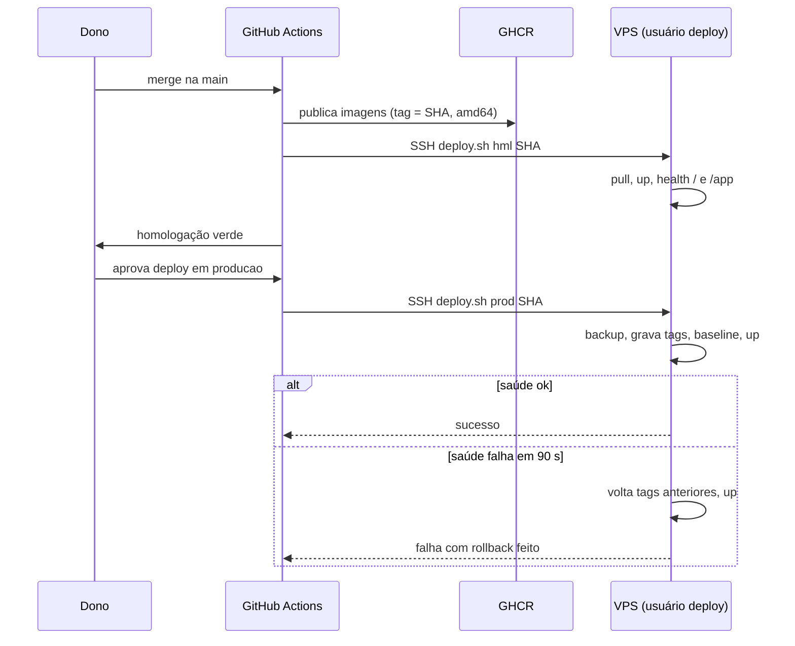

# Design: Fundação: instalação single-server, CI/CD, backups e isolamento

> Mudança `001-fundacao-instalacao-single-server-ci-cd-backups-e-isolamento` · porte L · 2026-10-22
> O COMO. Respeita `.sdd/constitution.md` e os padrões que já existem no código.
> Seção que não se aplica: escreva "N/A — motivo".

## Abordagem

**Princípio:** não reescrever o kit do DeskcommCRM. Tudo o que é nosso fica em pastas novas
(`infra/solucao/`, `caddy-sites/*.caddy` local, `.github/workflows/deploy-*.yml`), e o kit
(`hostgator-setup-kit/`, `docker-compose.*.yml`, `Caddyfile.single-server`) é usado como está. Assim o
PR de sincronização com o upstream continua barato (spec, seção 4).

**1. Portas (REQ-001, V-4).** O Caddy do kit em `crm-prod` é o único com `ports 80/443`. O vava
deixa de publicar portas no host: o container `valesca_almeida_website` entra na rede Docker
`<projeto>_caddy-sites` (a "gaveta" do kit) e o Caddy do CRM o publica com um arquivo
`caddy-sites/vava.caddy` (`valescaalmeida.com { reverse_proxy valesca_almeida_website:80 }`). O Caddy
do vava passa a servir HTTP puro (`auto_https off` / endereço `http://`), porque o TLS agora é do Caddy
do CRM. Ordem da troca (uma janela, ≤ 5 min): copiar `/opt/vava` → subir `crm-prod` sem publicar
portas → parar o vava → reconfigurar o vava sem `ports` e com a rede → subir o Caddy do CRM
em 80/443 → conferir os dois domínios. Reversão: voltar o `docker-compose.yml` do vava da cópia e
parar o Caddy do CRM.

**2. Ambientes (REQ-002/003).** Dois projetos Docker na mesma VPS, em pastas distintas:
`/opt/crm-prod` (compose do kit + `docker-compose.single-server.yml`, Supabase self-hosted) e
`/opt/crm-hml` (compose do kit **sem** o serviço `caddy`, banco no Supabase Cloud Free). Só existe um
Caddy: o `app` de homologação entra na rede `crm-prod_caddy-sites` e `caddy-sites/hml.caddy` o publica
em `hml.corretora.io`. Assim 80/443 continuam com um dono, e produção e homologação não dividem banco,
`.env` nem volumes.

**3. Imagens e deploy (REQ-004/005/006).** O CI já publica as imagens em
`ghcr.io/<dono>/{deskcommcrm,deskcomm-worker,deskcomm-scheduler}` com tag do SHA do commit na `main`
(`publish-image.yml`). O deploy usa **a tag do SHA** (imutável), nunca `latest`. O repositório é
privado, então os pacotes GHCR também são: o usuário `deploy` faz um único `docker login ghcr.io` com um
token só de leitura de pacotes (passo humano, guardado fora do chat). Dois workflows novos:
`deploy-hml.yml` (após `publish-image` verde na `main`) e `deploy-prod.yml` (`workflow_dispatch`
no ambiente `producao`, que exige aprovação). Ambos fazem SSH como `deploy` e chamam **um único script**
versionado, `infra/solucao/deploy.sh <ambiente> <sha>`, com `concurrency` por ambiente (sem dois
deploys juntos). O script: (a) backup (`backup.sh`, só em produção); (b) grava as tags atuais; (c)
atualiza `APP_IMAGE`, `WORKER_IMAGE` e `SCHEDULER_IMAGE` no `.env`; (d) reaplica o `baseline.sql` do
commit; (e) `docker compose -f docker-compose.prod.yml -f docker-compose.single-server.yml up -d`
(prod) ou só o prod.yml (hml); (f) espera até 90 s por `/` = 200 e `/app` = 307; (g) se falhar,
regrava as tags anteriores e repete (e) — rollback sem tocar o banco, porque toda migration é
compatível com a versão anterior (D-05).

**4. Backup externo (REQ-007).** `backup.sh` do kit gera banco, sessões do WAHA e Storage e já guarda 14.
Não envia para fora. Acrescentamos `infra/solucao/backup-externo.sh`, chamado depois do `backup.sh`
pelo cron do `deploy`: criptografa cada arquivo com `age` (chave pública na VPS; a **chave privada só no
gerenciador de senhas do dono**, assim nem a VPS consegue ler o backup) e envia ao bucket R2 com
`rclone` (S3). Credencial do R2 só no `.env` da VPS, limitada ao bucket. Falha → alerta (Sentry/e-mail).
Retenção externa: regra de ciclo de vida do bucket (30 dias; ajustável).

**5. Isolamento (REQ-008).** Usuários: `deploy` (grupo `docker`, só entra pela chave do pipeline, shell
normal restrito por `authorized_keys` com `command=` para `infra/solucao/deploy.sh`), `dev` (Claude
Code, sem `docker`, sem leitura de `/opt/crm-*`) e `root` (só o dono, ações pontuais). Atalho de leitura:
`/usr/local/bin/crm-status`, um script de `root` liberado ao `dev` por `sudoers` (um comando exato, sem
argumentos livres), que imprime `docker ps` e `docker logs --tail` filtrados de segredos (padrões de chave
e `.env` mascarados). Ações administrativas ficam em `infra/solucao/admin/NN-nome.sh`, mostradas ao dono
antes de rodar.

**6. Recursos (REQ-009).** Swap de 4 GB (`/swapfile`, no `fstab`). Limites de memória/CPU em
`docker-compose.solucao.yml` (override nosso, não editamos os arquivos do kit): `mem_limit` e `cpus`
por serviço, `cpu_shares` maior na produção. `voice-agent` não é iniciado (`profiles`/`--scale 0` no
override). A medição de 24 h usa um cron que grava `free -m` e `docker stats` em arquivo; o aviso de
"memória livre < 2 GB por mais de um dia" vai pelo mesmo canal de alerta do backup.

**7. DNS e firewall (REQ-010).** Registros A na Hostinger (`app`, `hml`, `*`) para o IP da VPS; os
antigos `app.`/`api.` são revistos. `ufw`: 22, 80, 443/tcp, 443/udp; fecha a 8000. Como o Docker
ignora o `ufw` para portas publicadas, nenhum serviço novo publica porta no host (só o Caddy do CRM),
e isso é conferido por teste (`ss -ltnp`).

**8. CI enxuto (REQ-004).** Ajustes nos workflows herdados: `ci.yml` e `e2e.yml` passam a rodar em PR só
`verify` e `invariants` com um Postgres (o do Supabase self-hosted) e o e2e completo apenas em `push` na
`main`; `publish-image.yml` perde a perna `arm64`; `acolhida`, `relogio`, `mysql-integracao` e
`release` são desligados com `if: false` no job raiz (preserva o diff pequeno, não apaga o arquivo). Um
passo `gitleaks` no `verify` cobre REQ-012. Nenhuma das mudanças toca o código do produto.

**Alternativas descartadas**
- *Caddy do vava como dono (opção 2 do diagnóstico):* amarra a configuração do CRM e o TLS por marca ao
  Caddyfile de um projeto alheio, com mudanças locais não enviadas.
- *Segundo Caddy para a homologação:* disputaria 80/443, o oposto do REQ-001.
- *Coolify/Dokploy:* sobe um painel que ocupa 80/443 e consome RAM; o kit já resolve com menos peças.
- *Deploy por `git pull` e build na VPS:* proibido pela doutrina de packaging do `CLAUDE.md`.
- *Backup sem criptografia local:* o R2 passaria a guardar dados de clientes em texto aberto.
- *Rollback por restauração de backup:* lento e perde dados; fica só para desastre (D-05).

## Componentes afetados

**Novos (código nosso, isolado):**
- `infra/solucao/deploy.sh` — deploy, health e rollback (REQ-005/006).
- `infra/solucao/backup-externo.sh` — criptografia `age` + envio R2 + alerta (REQ-007).
- `infra/solucao/crm-status.sh` — atalho de leitura sem segredos (REQ-008).
- `infra/solucao/admin/` — scripts de administração numerados: `01-swap.sh`, `02-firewall.sh`,
  `03-usuarios.sh`, `04-mover-vava.sh`, `05-cron.sh` (REQ-001/008/009/010).
- `infra/solucao/docker-compose.solucao.yml` — limites de recursos e `voice-agent` desligado.
- `infra/solucao/caddy-sites/vava.caddy.exemplo` e `hml.caddy.exemplo` — modelos; os reais ficam em
  `caddy-sites/` na VPS (a pasta não é versionada, por desenho do kit).
- `infra/solucao/medir-memoria.sh` — coleta de 24 h e alerta (REQ-009).
- `.github/workflows/deploy-hml.yml`, `.github/workflows/deploy-prod.yml` (REQ-005).
- `tests/infra/` — testes de shell da fundação (ver Estratégia de testes).
- `docs/solucao-crm/runbooks/fundacao.md` — instalação, restauração, rollback, troca de portas.

**Alterados (mudança mínima nos herdados):** `.github/workflows/ci.yml`, `e2e.yml`, `publish-image.yml`
(gatilhos e matriz); `acolhida.yml`, `relogio.yml`, `mysql-integracao.yml`, `release.yml` (desligados);
`.sdd/constitution.md` (decisão sobre a imagem só amd64).

**Fora do repositório (VPS):** `/opt/crm-prod`, `/opt/crm-hml`, `/opt/vava` (compose e Caddyfile
ajustados), `~deploy/.docker/config.json`, `/etc/sudoers.d/crm-status`, `/etc/fstab`, `ufw`.

## Fluxo

## Contratos e interfaces

- **`deploy.sh <hml|prod> <sha>`** → saída 0 = no ar na versão nova; 10 = falhou e voltou à anterior;
  11 = falhou e **não** conseguiu voltar (alerta crítico). Idempotente: repetir o mesmo `sha` não muda
  nada. Recusa `sha` que não seja hexadecimal de 40 caracteres e recusa `latest`.
- **`backup-externo.sh`** → saída 0 = todos os arquivos enviados e verificados por tamanho/hash; ≠ 0 =
  alerta enviado. Variáveis: `R2_ENDPOINT`, `R2_BUCKET`, `R2_ACCESS_KEY_ID`, `R2_SECRET_ACCESS_KEY`,
  `AGE_RECIPIENT` (chave pública). Nenhuma é logada.
- **`crm-status.sh`** → texto; nunca imprime variáveis de ambiente nem conteúdo de `.env`.
- **Variáveis novas no `.env` da VPS** (ficam em `.env.example`/`lib/env.ts` só se o app as ler; estas
  são lidas apenas pelos scripts de infra, então vão em `infra/solucao/.env.example`).
- **Secrets do GitHub:** `SSH_HOST`, `SSH_PORT`, `SSH_USER`, `SSH_PRIVATE_KEY` (guia, seção 1.5).
- **Saúde:** `GET /` = 200 e `GET /app` = 307 (CLAUDE.md); `/api/v1/health` para o monitor externo.

## Modelo de dados

N/A — nenhuma tabela ou migration nova. O deploy reaplica o `supabase/baseline.sql` do commit (idempotente,
como o `update.sh` do kit). Regra herdada para os próximos subprojetos: toda migration deve ser
compatível com a versão anterior do app (adicionar, nunca apagar/renomear no mesmo deploy), conferida no
checklist do PR (AC-006.4).

## Decisões (ADRs)

### ADR-001: Um Caddy único (o do CRM) é dono de 80/443; vava e homologação são publicados por ele
- Contexto: o requisito do dono proíbe dois donos de 80/443; o kit só suporta Caddy próprio ou Traefik; o
  TLS sob demanda das marcas (subprojeto 1) exige que o Caddy consulte o nosso app.
- Decisão: o Caddy de `crm-prod` é o único em 80/443. Vava e `crm-hml` entram na rede `caddy-sites` e são
  publicados por arquivos `.caddy` locais. Nenhum outro container publica porta no host.
- Consequências: troca com ~1–5 min de indisponibilidade do vava; o Caddyfile do vava muda para HTTP
  interno; o certificado de `valescaalmeida.com` é reemitido pelo novo Caddy. Um defeito no Caddy do CRM
  derruba os três sites (aceito; mitigado pelo monitor e pelo rollback).

### ADR-002: Deploy por script único via SSH, com imagem imutável por SHA e rollback por tag
- Contexto: precisamos de deploy com aprovação humana, rollback < 2 min, sem build na VPS e sem painel
  extra consumindo RAM.
- Decisão: `deploy.sh` (versionado) executado pelo `deploy` via chave restrita; produção pelo ambiente
  `producao` com aprovação; tags imutáveis do SHA; rollback regravando as tags anteriores.
- Consequências: o banco não volta com o app (depende da regra de migration compatível); a chave de
  deploy é a peça mais sensível — por isso restrita por `command=` e sem uso fora do pipeline.

### ADR-003: Backup externo criptografado com `age` e envio por `rclone` ao R2
- Contexto: banco dentro da VPS; perda sem cópia externa é irrecuperável (D-11); dados de clientes.
- Decisão: criptografia assimétrica na VPS (a VPS só tem a chave pública); envio S3 com credencial
  restrita ao bucket; bucket privado.
- Consequências: perder a chave privada = perder os backups (guardar em dois lugares do gerenciador de
  senhas); a restauração exige a chave, o que prova o AC-007.4.

### ADR-004: Imagens só linux/amd64 (divergência consciente da doutrina de packaging)
- Contexto: o `CLAUDE.md` do upstream manda publicar amd64 e arm64; nossa VPS é x86 e a cota de minutos
  do GitHub é limitada (D-06).
- Decisão: publicar só amd64. Registrada na constituição como decisão de adoção.
- Consequências: instalar em ARM exigiria reativar a perna arm64; o upstream continua sendo a referência
  caso isso mude.

## Riscos e casos extremos

- **Troca de portas falha no meio:** vava fora do ar. Mitigação: cópia prévia, script `04-mover-vava.sh`
  com reversão (`--desfazer`), ordem que deixa o vava parado o menor tempo, janela combinada com o dono.
- **Reemissão do certificado de `valescaalmeida.com`:** o ACME precisa de 80 livre no novo Caddy; o Let's
  Encrypt tem limite de emissões, mas uma emissão é segura. Se falhar, o site sobe com erro de certificado
  até repetir; documentado no runbook.
- **Alterações locais não enviadas em `/opt/vava`:** copiadas para fora da pasta antes de qualquer
  mudança e, com o "ok" do dono, versionadas no repositório do vava.
- **Concorrência:** `concurrency` do GitHub por ambiente + trava `flock` no `deploy.sh` (dois deploys
  nunca se sobrepõem).
- **Rollback falha:** saída 11 e alerta; o procedimento manual está no runbook; o backup pré-deploy é a
  última rede.
- **Memória:** estimativa de 9–11 GB; AC-009.5 mede e corrige antes da produção. Se faltar, `crm-hml` é
  o primeiro a ser desligado.
- **Supabase Cloud Free pausa:** a homologação pode acordar lenta; o smoke test tem tolerância de 90 s.
- **Segredos:** nada nos logs (`set +x`, mascaramento do Actions), nada no repositório (gitleaks), chave de
  deploy sem uso fora do pipeline; PR de fork não recebe segredos (ambiente `producao` e evento de PR sem
  acesso).
- **Chave `age` perdida:** backups ilegíveis. Guardar a privada em dois lugares; o teste de restauração
  (AC-007.4) prova que a chave guardada funciona.
- **Reuso do `update.sh`:** o kit atualiza por tag de release e por checkout git; nosso deploy é por SHA
  de imagem. A primeira tarefa de implementação confirma, numa leitura curta, quais funções de
  `_common.sh` (`reaplicar_baseline`, health) o `deploy.sh` reaproveita, para não duplicar lógica do kit.

## Estratégia de testes

Camada mais baixa que prova cada critério. Scripts de infra são testados em shell com contêineres
descartáveis (padrão do repositório: `tests/shell/*.test.sh`), citando o ID no nome do caso.

| REQ | Critérios | Camada | Como |
|---|---|---|---|
| 001 | AC-001.1, .3 | CHECK-SMOKE (VPS) | `ss -ltnp` mostra só o Caddy do CRM em 80/443; sonda externa na porta interna do vava recusa |
| 001 | AC-001.2, .5 | CHECK-SMOKE (VPS) | `curl` em `valescaalmeida.com`; indisponibilidade medida por laço de `curl` durante a troca |
| 001 | AC-001.4 | TEST-INT | `04-mover-vava.sh` em diretório de teste: cria a cópia e o `--desfazer` restaura byte a byte |
| 002 | AC-002.1–.3 | CHECK-SMOKE (VPS) | `curl` em `/`, `/app`, `/api/v1/health`; sonda externa nas portas do Studio/Postgres |
| 002 | AC-002.4, .5 | TEST-INT | `docker compose config` não contém `voice-agent`; instalador com `.env` incompleto falha com mensagem |
| 003 | AC-003.1–.3 | CHECK-SMOKE + TEST-INT | `curl` em `hml`; comparação de `.env`/volumes/redes entre os dois projetos |
| 004 | AC-004.1–.4 | TEST-INT | teste lê os YAML dos workflows (padrão de `tests/unit/e2e-cobertura-completa.test.ts`): gatilhos, matriz sem arm64, jobs desligados |
| 004 | AC-004.5 | CHECK-SMOKE (manual) | registro do consumo no primeiro mês em `docs/solucao-crm/runbooks/fundacao.md` |
| 005 | AC-005.1–.3, .5 | TEST-INT | `deploy.sh` contra Docker local com imagens de mentira: tag fixa, recusa `latest`, trava `flock`; workflow lido por teste |
| 005 | AC-005.4 | TEST-INT | teste do YAML: `deploy-prod` só em `workflow_dispatch` + ambiente `producao`, sem gatilho de PR |
| 006 | AC-006.1–.3 | TEST-INT + CHECK-SMOKE | falha provocada (imagem que não sobe) em Docker local e depois em `crm-hml`; tempo medido < 120 s |
| 006 | AC-006.4 | DOCS | item no template de PR (`.github/pull_request_template.md`) |
| 007 | AC-007.1–.2, .5, .6 | TEST-INT | `backup-externo.sh` contra MinIO local: arquivo criptografado, retenção, falha gera alerta |
| 007 | AC-007.3 | CHECK-SMOKE | `curl` ao bucket sem credencial devolve 403 |
| 007 | AC-007.4 | CHECK-SMOKE (manual) | restauração em ambiente descartável com a chave do gerenciador de senhas |
| 008 | AC-008.1–.3 | CHECK-SMOKE (VPS) | como `dev`: `docker ps` e `ls /opt/crm-prod` negados; `crm-status` não imprime padrões de segredo |
| 008 | AC-008.4 | TEST-INT | `authorized_keys` do `deploy` contém `command=` e restrições; teste lê o arquivo gerado |
| 008 | AC-008.5 | TEST-UNIT | teste confere que cada ação de `admin/` tem script versionado e `--dry-run` |
| 009 | AC-009.1–.2 | CHECK-SMOKE (VPS) + TEST-INT | `swapon --show`, `fstab`; `docker inspect` com limites; teste do override |
| 009 | AC-009.3–.5 | CHECK-SMOKE (manual) | `medir-memoria.sh` por 24 h; alerta simulado abaixo do limiar |
| 010 | AC-010.1–.4 | CHECK-SMOKE | `nslookup`; `ufw status`; varredura externa de portas |
| 011 | AC-011.1–.2 | CHECK-SMOKE (manual) | derrubar homologação de propósito e conferir o alerta; erro de teste no Sentry |
| 012 | AC-012.1–.2 | TEST-INT | `gitleaks` reprova um segredo falso plantado; log de `deploy.sh` não contém o valor |

**Citação do ID:** cada caso de shell leva o ID no nome (`caso "AC-006.2: volta à imagem anterior"`); o
verificador da esteira procura o ID nos testes. Critérios marcados "(manual)" ou "(VPS)" têm evidência
guardada em `docs/solucao-crm/evidencias/001-fundacao/` (saída dos comandos, sem segredos).

**Gates:** `bash tests/infra/*.test.sh` para a infra nova; `pnpm test:shell` e `pnpm verify`
(`gov:verify`) não podem regredir; a constituição manda rodar `pnpm test:db` só se schema mudar (não muda).
