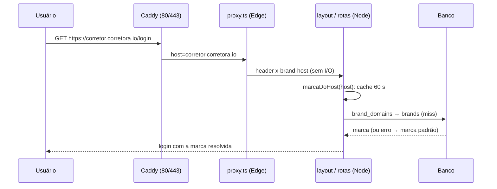
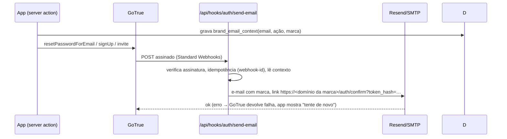

# Design: Marcas, parceiros e domínios

> Mudança `002-marcas-parceiros-e-dominios` · porte L · 2026-10-25
> O COMO. Respeita `.sdd/constitution.md` e os padrões que já existem no código.
> Seção que não se aplica: escreva "N/A — motivo".

## Abordagem

Hoje a marca é resolvida em duas camadas **sem host**: `platform_branding` (linha única, memoizada 30 s em `lib/branding/instalacao.ts`) e `organizations.settings.branding`. O resolvedor puro `resolverMarca(camadas, regua)` (`lib/branding/resolve.ts`) empilha camadas; o layout raiz (`app/layout.tsx:72-80`) usa instalação + ambiente. O desenho **acrescenta uma camada nova, a de MARCA**, entre a organização e a instalação, e um jeito de saber **qual marca** pelo endereço. A hierarquia entra no banco por **tabelas novas e uma coluna aditiva** (`organizations.brand_id`), sem alterar nada existente.

1. **Resolução do host (servidor Node, não Edge).** O `proxy.ts` roda no Edge e só **normaliza o host e o repassa** num header de requisição (`x-brand-host`), sem consultar banco. Quem consulta é um módulo de servidor `lib/branding/marca-do-host.ts`, chamado pelo layout raiz e pelas rotas, com **cache em memória por host** (validade de 60 s, invalidado pelo CRUD) e **degradação para a marca padrão** em qualquer falha (o resolvedor continua a nunca lançar).
2. **Marca padrão herda, não copia.** A migração cria a marca padrão com campos visuais **nulos**: ela herda de `platform_branding` e do ambiente. Assim nome, logo e cor são idênticos aos de hoje (AC-002.2) e editar a marca da instalação continua valendo para a padrão. Marcas de vertical sobrescrevem campo a campo.
3. **Precedência** (D-07): organização > marca > plataforma (`platform_branding`) > ambiente > padrão do produto. Antes do login (layout raiz, e-mails de acesso, erros) só entra a marca; dentro do app a camada da organização vale por cima, salvo `permite_personalizacao = false`.
4. **Organização ligada à marca** por `organizations.brand_id` (aditivo, `NULL` = marca padrão). A **visão filtrada** (identidade única) é uma guarda na camada de aplicação, porque o banco não conhece o host: toda rota que escolhe a organização ativa confere `org.brand_id == marca do host` (ou admin da plataforma).
5. **E-mails de acesso** (D-06): GoTrue chama o **gancho de envio** (`/api/hooks/auth/send-email`, assinatura Standard Webhooks). Como o fork hoje **não** usa o gancho (GoTrue envia direto por SMTP com moldes por URL, sem contexto de marca), o app grava, **antes** de pedir o e-mail ao GoTrue, uma linha de **contexto** (`brand_email_context`: e-mail + ação → marca). O gancho lê esse contexto, monta o e-mail com a marca e o link direto no domínio dela (`/auth/confirm?token_hash=…`, que o fork já trata) e envia pelo roteador existente (`lib/email/roteador.ts`: Resend ou SMTP). Não depende da lista de redirecionamentos do GoTrue.
6. **HTTPS sob demanda** (D-08): `on_demand_tls { ask … }` no bloco global dos dois Caddyfiles (inofensivo sozinho) e o **site que usa `tls { on_demand }` só entra por `caddy-sites/marcas.caddy`**, arquivo que o operador cria quando a prova da homologação estiver registrada (AC-007.6). A pergunta vai a uma rota **interna** do app.
7. **Painel** (`/admin/marcas`): páginas e rotas `app/api/v1/admin/brands/*` no padrão do fork (`requirePlatformAdmin`, `requireSupportWrite(` antes do efeito, `audit(...)`).

**Alternativas descartadas:**
- *Resolver a marca no Edge (`proxy.ts`) com consulta ao banco*: o Edge não é lugar para I/O de banco por requisição e o proxy já é caminho crítico de sessão.
- *Copiar a marca atual para a marca padrão na migração*: criaria duas fontes de verdade; herdar elimina a divergência.
- *Descobrir a marca pelo `redirect_to` do gancho*: o GoTrue substitui um `redirect_to` fora da lista permitida pelo `SITE_URL`, perdendo o host; a tabela de contexto é determinística e independe da lista.
- *Dispensar o gancho e gerar links com `generateLink`*: funcionaria, mas reverte a decisão D-06 aceita pelo dono; fica registrado como saída se o gancho se mostrar instável.
- *Certificado curinga por DNS*: a Hostinger não garante API de DNS, e não resolve domínio próprio.

## Componentes afetados

**Novos**
- `supabase/migrations/<ts>_0717_marcas_parceiros_e_dominios.sql` (número provisório: conferir com `pnpm checar:colisao-de-migration`) + **apêndice idempotente** no fim de `supabase/baseline.sql`, antes da "VARREDURA anon".
- `lib/branding/marca-do-host.ts` (host → marca, cache, flag), `lib/branding/camada-de-marca.ts` (linha de `brands` → camada), `lib/brands/` (tipos Zod, repositório com `createAdminClient`, `orgPertenceAMarca`).
- `app/api/hooks/auth/send-email/route.ts` (gancho assinado) e `lib/email/acesso-da-marca.ts` (monta e-mail por marca).
- `app/api/internal/tls-ask/route.ts` (pergunta do Caddy).
- `app/api/v1/admin/brands/**` (marcas, domínios, planos, pacotes, troca de marca da organização) e `app/admin/(protected)/marcas/**` (páginas), com item no menu em `components/admin/AdminShell.tsx`.
- `caddy-sites/marcas.caddy.exemplo` (modelo do site com `tls { on_demand }`).
- Testes: `tests/invariants/marcas-isolamento.test.ts`, `tests/unit/marcas-*.test.ts`, `tests/infra/caddy-on-demand.test.sh`, `tests/e2e/marcas.spec.ts`.

**Alterados**
- `proxy.ts`: normaliza `host`/`x-forwarded-host` e define `x-brand-host` (sem I/O); `lib/auth/public-paths.ts`: libera `/api/hooks/auth/send-email` (assinado) e `/api/internal/tls-ask` (sem sessão, protegido por token e por rede).
- `lib/branding/resolve.ts`: nova `CamadaDeMarca` na pilha; `app/layout.tsx` e `app/(public)/layout.tsx`: passam a marca do host; `lib/branding/saida.ts`: `marcaDaSaida` aceita marca explícita.
- `app/actions/auth/signUp.ts`, `requestPasswordReset.ts`, `lib/auth/issue-invite.ts`, `lib/auth/provision.ts` (`ensureTenantForUser`): gravam o contexto de e-mail, honram `cadastro_aberto`, ligam `brand_id` e copiam o pacote.
- `lib/audit/actions.ts`: novas ações (`brand.*`, `brand_domain.*`, `brand_plan.*`, `vertical_pack.*`, `org.brand_changed`).
- `lib/env.ts` e `.env.example`: `MARCAS_POR_DOMINIO`, `AUTH_HOOK_SECRET`, `TLS_ASK_TOKEN`, `VPS_PUBLIC_IP` (todas opcionais, com padrão que não quebra `.env` antigo).
- `Caddyfile` e `Caddyfile.single-server`: `on_demand_tls { ask … }` global e bloqueio público de `/api/internal/*`.
- `hostgator-setup-kit/supabase-single-server.override.yml`: expõe `GOTRUE_HOOK_SEND_EMAIL_ENABLED/_URI/_SECRETS` (padrão desligado).
- `tests/unit/branding.test.ts` (catraca de marca): conhece a camada nova.

## Fluxo

## Contratos e interfaces

- `marcaDoHost(host: string): Promise<{ brand: Brand; domainKind: "padrao"|"subdominio"|"proprio" }>` — **nunca lança**; com `MARCAS_POR_DOMINIO=off` devolve a padrão sem consultar o banco.
- `orgPertenceAMarca(org: {brand_id|null}, brand: Brand, user): boolean` — usada onde a organização ativa é escolhida; admin da plataforma passa.
- **`POST /api/hooks/auth/send-email`** — corpo do GoTrue (`user`, `email_data: {token_hash, email_action_type, ...}`). Cabeçalhos `webhook-id`, `webhook-timestamp`, `webhook-signature` (HMAC-SHA256, tolerância de 5 min, `crypto.timingSafeEqual`). Respostas: `200 {}` enviado; `401` assinatura inválida (nada enviado); `200` repetido (mesmo `webhook-id`, não reenvia); `5xx` falha de envio (GoTrue propaga o erro ao app).
- **`GET /api/internal/tls-ask?domain=<host>&token=<AUTH>`** — `200` = "sim"; `403` = "não". Só aprova quando: token correto (comparação em tempo constante), sem `x-forwarded-for` (chegou direto da rede do Caddy, não pela borda), domínio **ativo** em marca **ativa**, DNS do domínio resolve para `VPS_PUBLIC_IP`, e emissões na última hora abaixo do limite (padrão 10). O token vai na URL porque o `ask` do Caddy não envia cabeçalho; é aceito porque o caminho **nunca é público** (o Caddy responde 404 a `/api/internal/*`) e o tráfego é interno — exceção à regra "chave nunca em query string", registrada no ADR-004.
- **Admin API** (todas `requirePlatformAdmin`, mutações com `requireSupportWrite(` antes do efeito e `audit(...)`): `GET|POST /api/v1/admin/brands`, `PATCH|DELETE .../brands/{id}`, `POST|DELETE .../brands/{id}/domains`, `GET|POST|PATCH .../brands/{id}/plans`, `GET|POST|PATCH /api/v1/admin/vertical-packs`, `PATCH /api/v1/admin/tenants/{id}/brand`. Erros no wrapper padrão `{ error: { code, message } }`; domínio duplicado = `409 brand_domain_exists`.
- Env: `MARCAS_POR_DOMINIO` (`off` desliga; padrão ligado), `AUTH_HOOK_SECRET` (vazio = gancho desligado, GoTrue segue com SMTP), `TLS_ASK_TOKEN`, `VPS_PUBLIC_IP`.

## Modelo de dados

Migração **só aditiva**, idempotente (`create … if not exists`, `add column if not exists`, políticas dentro de `DO … IF NOT EXISTS`), com `-- manifest:` na primeira linha e o mesmo bloco no apêndice do `baseline.sql`.

| Tabela | Colunas principais | Isolamento (RLS) |
|---|---|---|
| `partners` | `id`, `slug` unique, `name`, `status` | admin da plataforma: tudo; admin do parceiro: só o próprio |
| `partner_members` | `partner_id`, `user_id`, `role` = `partner_admin`, `revoked_at` | idem; base do papel "admin do parceiro" (sem telas) |
| `brands` | `id`, `partner_id`, `slug` unique, `name`, `status`, `is_default` (índice único parcial), `app_name`, `logo_path`, `logo_dark_path`, `favicon_path`, `accent_hex`, `accent_dark_hex` (todos nulos = herdam), `sender_name`, `reply_to`, `support_email`, `default_pack_id`, `cadastro_aberto` (padrão `false`), `permite_personalizacao` (padrão `true`), `mobile` jsonb | plataforma: tudo; parceiro: as suas; membro de organização: **só leitura** da marca da própria organização |
| `brand_domains` | `id`, `brand_id`, `host` citext **unique**, `kind` (`subdominio`/`proprio`), `status`, `dns_ok_at`, `cert_requests` | só plataforma e parceiro; org comum **não** lê |
| `brand_plans` | `id`, `brand_id`, `name`, `limits` jsonb, `price_cents`, `currency` (`BRL`), `cycle`, `status` | marca própria (leitura) / plataforma e parceiro (escrita) |
| `vertical_packs` | `id`, `slug` unique, `name`, `version`, `seed` jsonb, `status` | plataforma: tudo; leitura via marca |
| `brand_email_context` | `email` citext, `action`, `brand_id`, `created_at`, `last_sent_at`, PK (`email`,`action`) | só `service_role` (limpeza > 1 dia) |
| `auth_hook_deliveries` | `webhook_id` PK, `received_at` | só `service_role` (limpeza > 1 dia) |
| `organizations.brand_id` | `uuid null references brands(id)` | herda a RLS atual; **trocar** só admin da plataforma (política e RPC com auditoria) |

- **Marca padrão:** a migração insere o parceiro `plataforma` e a marca `padrao` (`is_default`, campos visuais nulos, `cadastro_aberto = false`) e **só então** faz `update organizations set brand_id = <padrão> where brand_id is null` (ou deixa `NULL`, tratado como padrão — o resolvedor aceita os dois).
- **Funções novas** (`fn_is_partner_admin(partner_id)`, `fn_user_partner_ids()`, RPC `fn_set_org_brand`): `security definer`, `set search_path`, e `revoke execute … from public, anon` + `grant` só a quem precisa (doutrina 9 do CLAUDE.md).
- **Rollback:** nenhuma coluna ou tabela existente é alterada; a imagem anterior ignora as novas. `MARCAS_POR_DOMINIO=off` + recriar o `app` (≈10 s) desliga o recurso.

## Decisões (ADRs)

### ADR-001: Resolver o host no servidor Node, com cache em memória
- Contexto: o `proxy.ts` roda no Edge (`proxy.ts:96-153`) e o layout raiz roda em Node; hoje não há host no caminho da marca.
- Decisão: o proxy só repassa `x-brand-host`; `marcaDoHost` (Node) consulta `brand_domains → brands` com cache por host de 60 s, invalidação no CRUD e **servir a última marca conhecida (ou a padrão) em erro**.
- Consequências: nenhum I/O novo no Edge; uma instância basta (cache local); se um dia houver mais de uma instância, a janela de 60 s absorve a inconsistência.

### ADR-002: Marca padrão herda de `platform_branding`
- Contexto: copiar valores criaria duas fontes de verdade e arriscaria mudar a produção.
- Decisão: campos visuais nulos na marca padrão; a camada de marca só sobrescreve o que tem valor.
- Consequências: AC-002.2 vale por construção; editar `/admin/marca` (instalação) continua refletindo na padrão.

### ADR-003: Contexto de e-mail em tabela + gancho assinado
- Contexto: o fork não usa o gancho hoje; o GoTrue não carrega marca e substitui `redirect_to` inválido pelo `SITE_URL`.
- Decisão: o app grava `brand_email_context` antes de pedir o e-mail; o gancho resolve a marca por ela, deduplica por `webhook-id` e bloqueia reenvio por 60 s (`last_sent_at`). Sem contexto (ex.: pedido que não veio do app) usa a marca padrão **sem nome de outra marca**.
- Consequências: determinístico e sem depender da lista de redirecionamentos; custo: uma escrita extra por pedido de e-mail. Se o gancho falhar, o e-mail não sai e o usuário vê o aviso (D-06).

### ADR-004: HTTPS sob demanda atrás de pergunta interna e de arquivo opt-in
- Contexto: abuso do `on_demand` esgota a cota do Let's Encrypt; produção só liga depois da prova (D-04, AC-007.6).
- Decisão: `on_demand_tls { ask }` no bloco global (sem efeito sozinho); o site `tls { on_demand }` vive em `caddy-sites/marcas.caddy`, criado só pelo operador; `/api/internal/*` bloqueado publicamente pelo Caddy; o `ask` exige token + ausência de `x-forwarded-for` + DNS na VPS + marca ativa + limite por hora.
- Consequências: a produção segue sem o recurso até a prova; o token na URL é exceção consciente à regra de "chave em query" (rede interna, caminho nunca público).

### ADR-005: `organizations.brand_id` aditivo e guarda de visão na aplicação
- Contexto: RLS não conhece o host; a "visão filtrada" depende da marca da requisição.
- Decisão: coluna `brand_id` opcional; guarda `orgPertenceAMarca` onde a organização ativa é escolhida e no seletor de organizações; RLS continua garantindo isolamento **entre organizações**, e as tabelas de marca têm RLS própria.
- Consequências: o teste de isolamento de banco cobre as tabelas de marca e parceiro; o filtro por host é coberto por teste de unidade e e2e.

### ADR-006: Painel e API no padrão do fork
- Decisão: rotas `app/api/v1/admin/*` com `requirePlatformAdmin`, `requireSupportWrite(`, `audit(...)` e wrappers `ok()/fail()`; páginas em `app/admin/(protected)/marcas`. Marca é dado global (não tenant): o repositório usa `createAdminClient` **sem** `organization_id`, e isso é registrado como exceção justificada à regra de filtrar organização.

## Riscos e casos extremos

- **Resolvedor derruba tudo:** nunca lança; qualquer erro → marca padrão + motivo registrado (AC-001.4); chave `off` (AC-002.1).
- **Cache obsoleto:** 60 s no pior caso; o CRUD invalida na hora na instância local (AC-001.5).
- **Gancho de e-mail:** assinatura inválida → 401; replay → idempotência por `webhook-id`; falha de envio → erro propagado ao app (aviso, reenvio travado 60 s, alerta Sentry); gancho **desligado** quando `AUTH_HOOK_SECRET` está vazio (GoTrue volta ao SMTP direto).
- **Concorrência:** domínio `unique` → `409` no segundo clique; `brand_email_context` com PK (`email`,`action`) e `upsert`; limite de emissões contado em transação atômica.
- **Abuso de TLS:** ver ADR-004; DNS fora da VPS, marca inativa ou domínio removido → "não"; certificado não renova.
- **Sessão entre marcas:** cookie `sb-deskcomm-auth` já é por host (sem `domain`), então a sessão de A não vale em B (AC-004.3).
- **Duas marcas, mesmo e-mail:** a identidade é única; a visão é filtrada pela guarda; link para organização de outra marca → 404 sem revelar existência (AC-004.2).
- **Kit/atualização:** variáveis novas com padrão vazio; `update.sh` de clone antigo segue funcionando; `pnpm test:shell` cobre o kit.
- **Homologação no Supabase Cloud:** o gancho é configurado à mão no painel (URL pública do gancho, segredo); documentado no runbook.
- **Segredos:** `AUTH_HOOK_SECRET` e `TLS_ASK_TOKEN` gerados com `openssl rand` e colocados no `.env` da VPS e no painel do Supabase; nunca no chat nem no repositório.
- **Marca e acessibilidade:** a régua de contraste existente ajusta ou recusa cores ruins com motivo (AC-010.2).

## Estratégia de testes

Camada mais baixa que prova cada critério; todo teste cita o ID (`it('AC-001.2: …')`, `-- AC-003.1` em SQL).

| REQ | Critérios | Camada | Onde |
|---|---|---|---|
| 001 | AC-001.1–.5 | unidade (resolvedor puro, cache, degradação) + e2e (login por host) | `tests/unit/marcas-resolucao.test.ts`, `tests/e2e/marcas.spec.ts` |
| 002 | AC-002.1–.5 | unidade (flag) + invariante de banco (migração em instalação e atualização com dados, imagem anterior) + medição do rollback | `tests/unit/marcas-flag.test.ts`, `tests/invariants/marcas-migracao.test.ts`, evidência de medição |
| 003 | AC-003.1–.5 | invariantes de banco (2 marcas, 2 organizações, 1 e-mail nas duas; admin do parceiro; revokes de `anon`/`PUBLIC`) | `tests/invariants/marcas-isolamento.test.ts` |
| 004 | AC-004.1–.3 | unidade (`orgPertenceAMarca`) + e2e | `tests/unit/marcas-visao.test.ts`, `tests/e2e/marcas.spec.ts` |
| 005 | AC-005.1–.6 | unidade (precedência, `permite_personalizacao`) + integração de rota (cadastro fechado/aberto, convite) + regressão do PDF de LGPD | `tests/unit/marcas-precedencia.test.ts`, `tests/unit/marcas-cadastro.test.ts` |
| 006 | AC-006.1–.5 | integração de rota (assinatura, idempotência, falha de envio, contexto ausente) + unidade do molde + prova real na homologação | `tests/unit/marcas-gancho-email.test.ts`, e2e |
| 007 | AC-007.1–.6 | integração da rota `tls-ask` (todas as negativas e o limite) + teste shell do Caddyfile (bloqueio público, `ask` global, `marcas.caddy` opt-in) + prova real | `tests/unit/marcas-tls-ask.test.ts`, `tests/infra/caddy-on-demand.test.sh` |
| 008 | AC-008.1–.7 | integração das rotas admin (CRUD, 409, 403, auditoria, `requireSupportWrite`) + UI (e2e leve) | `tests/unit/marcas-admin-api.test.ts`, `tests/e2e/marcas.spec.ts` |
| 009 | AC-009.1–.4 | smoke e prova pela tela na homologação, com evidências | `docs/solucao-crm/evidencias/002-marcas/` |
| 010 | AC-010.1–.5 | unidade (desempenho do resolvedor, contraste) + `pnpm test:db` (install e update) + `pnpm test:shell` + catraca `branding.test.ts` | `tests/unit/marcas-desempenho.test.ts`, `tests/unit/branding.test.ts` |

- **Fatias previstas** (para as tarefas): (1) schema, migração, baseline e RLS com testes de isolamento; (2) resolvedor, camada de marca, flag e proxy; (3) painel e API de marcas, domínios, planos e pacotes; (4) cadastro fechado/aberto, convite, `brand_id` e visão filtrada; (5) e-mails de acesso (contexto + gancho + moldes + kit); (6) HTTPS sob demanda (`tls-ask` + Caddy); (7) prova pela tela na homologação e liberação em produção.
- **DoD do repositório:** `pnpm typecheck`, `pnpm lint`, `pnpm test:unit`, `pnpm test:db`, `pnpm test:shell` e, antes de entregar, **e2e disparado à mão** (A-07). Doutrinas citadas: migration + apêndice, função nova revogada de `PUBLIC`/`anon`, `requireSupportWrite(` nas mutações, audit nas ações novas, tela nova com porta no menu do admin.
