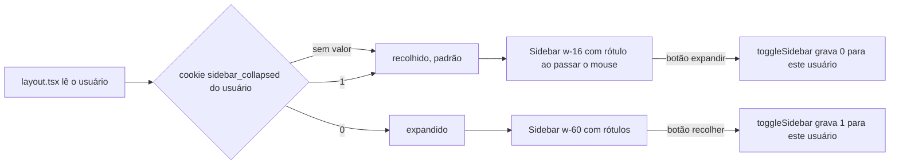

# Design: Visual no estilo WhatsApp em todo o sistema

> Mudança `009-visual-no-estilo-whatsapp-em-todo-o-sistema` · porte L · 2026-10-29
> O COMO. Respeita `.sdd/constitution.md` e os padrões que já existem no código.
> Seção que não se aplica: escreva "N/A — motivo".

## Abordagem

**Achado do levantamento no código, que encolhe o trabalho:** boa parte do que o PRD pede já existe.
A casca do tenant (`app/app/_components/AppShell.tsx`) já tem barra lateral que recolhe para ícones
(`components/shell/Sidebar.tsx`: `w-16` recolhida, `w-60` expandida, `title` com o nome do item,
`sr-only`, botão de recolher), a gaveta do celular (`components/shell/MobileSidebar.tsx`) e a barra
de abas de baixo com quatro destinos e "Mais" (`components/shell/BarraInferior.tsx`), tudo
alimentado por `sidebarGroups()` a partir do `NAV_CATALOG` (`lib/navigation/catalogo.ts`). O que
falta é: o padrão hoje é **expandido** (`app/app/layout.tsx` lê o cookie `sidebar_collapsed`, e sem
cookie fica expandido), o cookie é **do navegador** e não da pessoa, e o resto do app não tem a
aparência de conversa.

Então a mudança tem três partes, em duas levas:

- **Leva 1 — casca:** (a) o padrão do menu passa a ser recolhido, e a escolha passa a ser por
  usuário; (b) tokens de superfície, cantos, tipografia e cabeçalho (`app/globals.css`) ajustados
  para o padrão de uso do WhatsApp, sempre com as cores da marca; (c) o cabeçalho (`TopBar`) e a
  barra de baixo alinhados aos tokens; (d) medição de contraste e de alvos de toque.
- **Leva 2 — listas como conversa:** um componente de linha compartilhado (`LinhaDeLista`) com
  avatar, título, prévia e informação à direita, usado por Contatos, Tarefas, Casos, Follow-ups e
  pelos cartões da Central. A lógica de cada tela (busca, filtro, ordenação, paginação, seleção em
  lote, ações) **não muda**; muda só o que é desenhado por item.
- **Sem mudança de dado:** nenhuma migration, rota ou permissão.

Alternativas descartadas:

- **Adotar uma biblioteca de componentes externa (ex.: Astryx, da Meta):** motor de estilo
  concorrente (StyleX) ao Tailwind 4 com tokens vigiados, temas fixos que brigam com o white-label,
  versão 0.7. Descartada em 29/10/2026, com o dono.
- **Reescrever a casca do zero como o WhatsApp Web:** maior e arrisca o que já funciona (a casca
  existente tem gates de rodapé ocupado, alvos de toque e safe-area, medidos).
- **Flag de "visual clássico":** dobra manutenção, prova pela tela e cercas (grill P5).

## Componentes afetados

Leva 1:
- `app/globals.css` — tokens de superfície, raios, tipografia e (se preciso) espaçamento, em `:root`
  e `[data-theme="dark"]`; ponte no `@theme inline`. Vigiado por `tests/unit/tailwind-tokens.test.ts`.
- `app/app/layout.tsx` — o padrão do menu (recolhido na ausência de preferência) e a leitura da
  preferência da pessoa.
- `app/actions/shell/toggleSidebar.ts` — grava a preferência por usuário (ver ADR-002).
- `components/shell/Sidebar.tsx` — rótulo ao passar o mouse e ao focar com teclado no estado
  recolhido (hoje `title` apenas), item ativo anunciado (`aria-current`), ajustes de tokens.
- `components/shell/TopBar.tsx`, `components/shell/BarraInferior.tsx`, `components/shell/MobileSidebar.tsx`
  — só tokens e medidas; a lógica de quais abas aparecem não muda.
- Textos novos (se houver) no `lib/i18n/dicionario.ts` com `es` obrigatório.

Leva 2:
- Novo `components/ui/linha-de-lista.tsx` — avatar (reusa `components/ui/avatar.tsx`), título,
  prévia, direita (horário ou situação), selecionável, com estados vazio/erro/carga herdados do
  chamador.
- `components/contacts/ContactsTable.tsx`, `app/app/tasks/_components/*`, listas de `app/app/ai/cases`
  e `app/app/ai/followups`, e os cartões de `app/app/ai/inbox/_components/*` — passam a desenhar por
  `LinhaDeLista`, mantendo as props e os handlers atuais.
- `components/inbox/ConversationListItem.tsx` (da 004) — referência do desenho, sem remendo: o
  componente novo reaproveita o que for comum.

Não tocados: rotas `app/api/**`, `lib/navigation/catalogo.ts` (fonte única, só consumida), migrations,
`supabase/baseline.sql`.

## Fluxo

## Contratos e interfaces

- **Cookie de preferência do menu:** `sidebar_collapsed_<userId>`, valores `"1"` (recolhido) e `"0"`
  (expandido), `httpOnly`, mesma política de `SameSite`, `Secure` e `path` do cookie atual.
  Ausente = recolhido. O cookie antigo `sidebar_collapsed` (sem usuário) deixa de ser lido; quem o
  tinha volta ao padrão recolhido, o que é a decisão D-03.
- **`toggleSidebar(currentlyCollapsed: boolean): Promise<void>`** — mesma assinatura. O `userId`
  vem de `supabase.auth.getUser()` no servidor, nunca do cliente. Sem usuário autenticado, não
  grava nada.
- **`LinhaDeLista`** (props): `avatar` (nome e imagem opcional), `titulo`, `previa?`, `direita?`,
  `selecionado?`, `onSelecionar?`, `href?`, `children?` (ações). Sem estado próprio.
- Nenhum endpoint, evento ou schema novo.

## Modelo de dados

N/A — nenhuma tabela, coluna, migration ou RLS muda. A preferência do menu é cookie, não dado do banco
(ADR-002).

## Decisões (ADRs)

### ADR-001: Estender a casca existente em vez de reescrevê-la
- Contexto: o menu recolhível, a gaveta do celular e a barra de baixo já existem, medidos e cobertos
  por testes (rodapé ocupado, safe-area, alvos de toque), e todos leem o `NAV_CATALOG`.
- Decisão: mudar o padrão e a aparência por tokens, e só acrescentar o que falta (rótulo no foco,
  preferência por usuário). Não criar casca nova.
- Consequências: menos risco e menos código; a "cara de WhatsApp" depende bastante dos tokens e da
  composição, o que a prova pela tela precisa mostrar.

### ADR-002: A preferência do menu é um cookie por usuário, sem banco
- Contexto: AC-001.4 pede que a escolha de uma pessoa não altere a de outra no mesmo navegador. Um
  cookie único (`sidebar_collapsed`) é do navegador. Guardar no banco exigiria migration, baseline e
  rota, para uma preferência de interface.
- Decisão: cookie `sidebar_collapsed_<userId>`, gravado pela Server Action existente. O
  `userId` é uuid, não é segredo e não vaza para outra pessoa porque o cookie é `httpOnly` e do
  navegador dela.
- Consequências: a escolha não acompanha a pessoa entre aparelhos (aceitável: no celular não há
  menu recolhível). Cookies acumulam por usuário no mesmo navegador (poucos, de tamanho mínimo).

### ADR-003: Um componente de linha compartilhado, lógica das telas intacta
- Contexto: cinco telas devem parecer lista de conversa, cada uma com busca, filtro, seleção em lote
  e ações próprias.
- Decisão: um `LinhaDeLista` puramente de apresentação; cada tela segue dona dos seus dados e
  handlers e só troca o desenho do item. A paginação e os estados vazio, de erro e de carga ficam
  onde estão.
- Consequências: AC-004.2 (comportamento idêntico) é verificável pelos testes existentes de cada
  tela, que não devem ser enfraquecidos; a Contatos, que hoje é tabela, precisa de cuidado com a
  seleção em lote e com colunas que somem na linha (as informações viram prévia e direita).

### ADR-004: Tokens primeiro, sem hex fora deles
- Contexto: a marca vem do banco e é aplicada por tokens; as cercas `branding.test.ts` e
  `tailwind-tokens.test.ts` reprovam cor fixa e verde de marca registrada.
- Decisão: todo ajuste visual entra como token em `app/globals.css` ou como classe de token; nenhum
  hex novo em componente. O verde do WhatsApp nunca entra (D-07).
- Consequências: o visual novo respeita qualquer marca; o ajuste fino de cor depende da paleta da
  marca, e a aprovação do dono é feita na marca padrão da instalação.

### ADR-005: Duas levas, cada uma com sua prova na homologação e sem flag
- Contexto: grill P5 e PRD REQ-007.
- Decisão: leva 1 (casca) e leva 2 (listas) como PRs e deploys separados na hml, cada um com
  capturas lado a lado e aprovação do dono antes da produção. Retorno pela imagem anterior.
- Consequências: a leva 2 só começa depois da aprovação da leva 1 em produção, para não acumular
  risco.

## Riscos e casos extremos

- **Tela que depende da largura do menu antigo** (tabelas largas, cartões): medir com
  `getBoundingClientRect` em 1440, 1024, 768 e 390 de largura em cada tela tocada.
- **Menu recolhido e destino escondido:** o `NAV_CATALOG` continua fonte única e o rótulo aparece no
  foco; `tests/unit/navegacao-completude.test.ts` segue valendo.
- **Primeira abertura depois do deploy:** todo mundo que nunca recolheu ou expandiu cai no padrão
  recolhido; o botão de expandir está sempre visível. Comunicar no fragmento de versão.
- **Cookie sem usuário ou com usuário trocado na mesma aba:** sem `userId`, nada é gravado e vale o
  padrão; ao trocar de usuário o cookie do outro é ignorado.
- **Contraste em cor de marca clara:** a medição roda na marca padrão e, para uma marca clara de
  teste, a casca não pode produzir texto abaixo de 4,5:1 (os tokens de texto da marca já são
  derivados com esse piso).
- **Contatos em lista perde colunas:** informação que hoje é coluna precisa continuar acessível
  (prévia ou detalhe); revisar com o dono nas capturas da leva 2.
- **Desempenho:** lista longa de linhas com avatar; manter a paginação e a virtualização atuais.

## Estratégia de testes

Camada mais baixa que prova cada critério; os testes citam o ID (`it("AC-001.1: ...")`).

| Critério | Camada | Como |
|---|---|---|
| AC-001.1, AC-001.3, AC-001.4 | Unitário de servidor e de componente | `layout`/`toggleSidebar`: sem cookie → recolhido; `0` → expandido; cookie de outro usuário é ignorado; a ação grava com o `userId` da sessão |
| AC-001.2, AC-001.6 | Componente (Testing Library) | rótulo no foco e no `hover`; `aria-current` no item ativo |
| AC-001.5, AC-006.3 | Unitário (cerca existente) | `navegacao-completude.test.ts` e um teste de que o recolhido renderiza todos os destinos de `sidebarGroups()` |
| AC-002.1, AC-002.2 | Componente | `BarraInferior`: 4 abas mais "Mais"; a gaveta lista o resto |
| AC-002.3, AC-002.4 | E2E de jornada (Playwright, 390 px) | sem rolagem lateral, alvos ≥ 44 px, barra não cobre o campo |
| AC-003.1, AC-003.3 | Unitário (cercas) | `tailwind-tokens.test.ts` e `branding.test.ts` verdes; busca de hex fora de tokens |
| AC-003.2 | E2E de jornada (Playwright + `getComputedStyle`) | contraste ≥ 4,5 nas telas principais, claro e escuro |
| AC-003.4 | Componente | testes existentes da 004 seguem verdes |
| AC-004.1 a AC-004.4 | Componente + os testes existentes de cada tela | `LinhaDeLista` e as telas tocadas; testes de comportamento existentes não enfraquecidos |
| AC-005.1, AC-005.2 | E2E de jornada | funil e agenda com a forma de antes e a casca nova |
| AC-006.1, AC-006.2 | Suíte + revisão de diff | `pnpm test:unit` verde; diff sem `app/api`, `supabase/` nem permissões |
| AC-007.1, AC-007.2 | Prova pela tela na hml com o dono | capturas lado a lado; aprovação antes do deploy |
| AC-007.3 | Smoke | voltar à imagem anterior na hml e medir `/` 200 e `/app` 307 |

Ambiente da prova: homologação (`hml.corretora.io`), com o build de produção, conta de teste, e
`getBoundingClientRect`/`getComputedStyle` para toda medida (doutrina de QA visual do CLAUDE.md).
