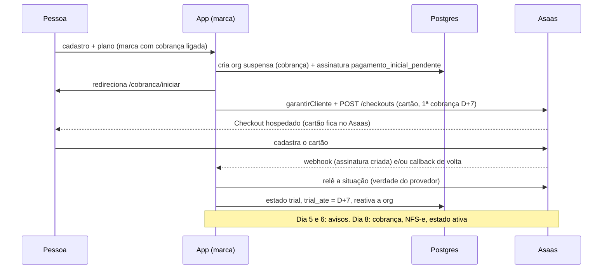

# Design: Billing com trial no cartão (Asaas)

> Mudança `003-billing-com-trial-no-cartao-asaas` · porte L · 2026-10-27
> O COMO. Respeita `.sdd/constitution.md` e os padrões que já existem no código.
> Seção que não se aplica: escreva "N/A — motivo".

## Abordagem

A cobrança do revendedor já existe e funciona por **instalação** (`lib/cobranca/**`, tabelas `cobranca_planos` e `cobranca_assinaturas`, régua, webhook, cron horário). Este design **não reescreve nada disso**: acrescenta um **segundo caminho, o "trial com cartão"**, que só liga numa marca com `brands.cobranca_ligada = true`. Marca desligada (o padrão) segue exatamente o caminho de hoje, o que sustenta AC-001.1, AC-002.x e AC-010.5.

Fatos do código que moldam a solução (levantados antes do design):
- O trial de hoje é **sem cartão**: o gatilho SQL `fn_trial_na_criacao_da_org` cria a assinatura em `trial` com `trial_ate = now()+trial_dias`. Já existe o mecanismo de **entrada paga** (`trial_dias = 0`): a org nasce com `pagamento_inicial_pendente = true` e suspensa por cobrança até pagar. O trial com cartão **reaproveita esse mecanismo**: a org nasce suspensa até o cartão ser aceito.
- O adaptador Asaas usa `POST /subscriptions` com `billingType: UNDEFINED` e `nextDueDate` = fim do teste; **não** usa o Checkout hospedado (`/v3/checkouts`) e não tem callback de volta.
- "Suspensa" não é estado da assinatura: vem de `organizations.status` e `suspended_kind`. Os ~30 choke points já respeitam isso; **nenhum será tocado**.
- O webhook identifica a org por `provedor_cliente_id` e usa um token por instalação, o que combina com a decisão D-01 (uma conta Asaas para todas as marcas).

Solução, em cinco peças:
1. **Chave por marca** `brands.cobranca_ligada` (default falso) e **planos por marca** (`cobranca_planos.brand_id`).
2. **Modo "trial com cartão"** no contrato do provedor: um método novo que cria o cliente e abre o **Checkout hospedado do Asaas** (assinatura recorrente, só cartão, primeira cobrança em hoje + `trial_dias`, URLs de retorno). O cartão nunca toca o nosso servidor (D-12).
3. **Cadastro em duas etapas**: a org nasce suspensa por cobrança com `pagamento_inicial_pendente`; a rota `/cobranca/iniciar` abre o checkout; o retorno e o webhook confirmam a assinatura e **reativam** a org em `trial`.
4. **Régua do cartão**: avisos "cobra em 2 dias" e "cobra amanhã" (dias 5 e 6 do teste de 7), tolerância de 3 dias no atraso, reembolso de arrependimento manual, e link da NFS-e lido sob demanda do Asaas.
5. **Painel**: planos por marca e chave de cobrança no editor de marcas; filtros por estado (incluindo "cortesia") nas contas.

Alternativas descartadas:
- **Tokenização própria de cartão:** traz escopo PCI. Só se a sonda V-1/V-2 falhar (D-03); então o design volta.
- **Reescrever a cobrança por marca:** arriscado para ~30 choke points e para quem já usa o módulo. O segundo caminho, ligado por marca, isola o risco.
- **Usar `brand_plans` (SP1) como catálogo cobrável:** ver ADR-002.
- **Coluna "cortesia" explícita:** ver ADR-003.
- **Aviso "dia 5/dia 6" fixo por data civil:** fica relativo ao `trial_ate` (a duração do teste é do plano).

## Componentes afetados

Novos (código isolado em `lib/billing-trial/`, como pede a spec 10):
- `lib/billing-trial/documento-hash.ts`: HMAC-SHA256 do CPF/CNPJ normalizado, com chave derivada de segredo de servidor; função pura de comparação.
- `lib/billing-trial/iniciar.ts`: orquestra "garantir cliente → criar checkout → gravar referências" com idempotência por org.
- `lib/billing-trial/confirmar.ts`: no retorno ou no sinal do webhook, confirma a assinatura, grava `trial_ate` e reativa a org.
- `lib/billing-trial/reembolso.ts`: regra pura da janela de 7 dias e criação idempotente do pedido.
- `lib/billing-trial/nota.ts`: lê o link da NFS-e do pagamento no Asaas, com cache curto e falha silenciosa.
- `app/cobranca/iniciar/route.ts`: abre o checkout e redireciona. `app/api/v1/cobranca/assinatura/reembolso/route.ts`: pedido de reembolso.
- `app/api/v1/admin/brands/[id]/cobranca/route.ts`: liga/desliga a cobrança da marca. `app/api/v1/admin/brands/[id]/planos-cobranca/route.ts`: planos cobráveis da marca. `app/api/v1/admin/cobranca/organizacoes/[id]/converter/route.ts`: converte cortesia em cobrada. Todas com `requireSupportWrite(` antes do efeito, `requirePlatformAdminEscrita()`, Zod e `audit()`.
- Telas: aba "Cobrança" no editor de marcas (`components/admin/marcas/`), filtro por estado em `PainelDeContas`, botão "Pedir reembolso" e link da nota em `components/cobranca/AcoesDaAssinatura.tsx` e `PainelDaAssinatura.tsx`.

Alterados (extensão mínima):
- `lib/cobranca/provedores/contrato.ts`: método opcional `iniciarTrialComCartao`. `asaas.ts`: implementação via `/v3/checkouts` com `callback`; `stripe.ts` não o implementa (a marca com cobrança exige Asaas).
- `lib/cobranca/regua.ts` e `avisos.ts`/`emails.ts`: dois avisos novos e tolerância de 3 dias para assinatura `trial_com_cartao`; o e-mail passa a usar o **host da marca** no botão (hoje usa `NEXT_PUBLIC_APP_URL`).
- `lib/cobranca/vocabulario.ts`: avisos novos (`trial_cobra_em_2_dias`, `trial_cobra_amanha`). `lib/cobranca/configuracao.ts`: piso da tolerância de 5 para 3.
- `lib/cobranca/cadastro.ts` e `app/actions/auth/signUp.ts`: leem os planos da marca da organização (e não só os da instalação) quando a marca cobra; `lib/auth/provision.ts` repassa marca e plano.
- `app/cobranca/volta/route.ts`: passa a chamar `confirmar` e aceita o retorno do callback do Checkout.
- `lib/brands/{schemas,admin-repo}.ts` e `components/admin/marcas/EditorDeMarca.tsx` / `PainelDePacotes`: planos da marca passam a ler `cobranca_planos` (ADR-002).

Não tocados: os ~30 choke points de org suspensa, `fn_suspender_organizacao`, `fn_reativar_organizacao`, `sinal.handler.ts`, `sincronizar.ts` (só estendidos pelos novos avisos), prorata e troca de plano.

## Fluxo



Estados (reaproveita o vocabulário existente): `em_teste = trial`, `ativa`, `pagamento_atrasado = em_atraso`, `suspensa = org.status + suspended_kind = cobranca`, `cancelada`. "Cortesia" é derivado (ADR-003).

## Contratos e interfaces

Contrato do provedor (acréscimo opcional, `contrato.ts`):
```ts
iniciarTrialComCartao?(p: {
  clienteRef: string; orgId: string; plano: PlanoParaProvedor;
  primeiraCobrancaEm: Date;           // hoje + trial_dias, data civil de São Paulo
  urlDeSucesso: string; urlDeCancelamento: string; urlDeExpirado: string; // no host da marca
  chaveIdempotencia: string;
}): Promise<{ url: string; sessaoId: string; expiraEm: Date | null }>;
```
Erros: `ErroDoProvedor` (já existe), nunca com texto livre do pagador. Provedor sem o método ⇒ marca não pode ligar a cobrança (AC-001.3).

Rotas novas (todas `ok()`/`fail()`, Zod, `X-Request-Id`):
| Rota | Quem | Efeito |
|---|---|---|
| `GET /cobranca/iniciar` | usuário da org suspensa por entrada paga | cria/reaproveita o checkout e redireciona (303) |
| `POST /api/v1/cobranca/assinatura/reembolso` | admin da org | cria pedido (idempotente por pagamento), cancela a conta |
| `PATCH /api/v1/admin/brands/[id]/cobranca` | admin da plataforma | liga/desliga a chave (valida AC-001.3), audita `brand.cobranca_changed` |
| `GET/POST/PATCH /api/v1/admin/brands/[id]/planos-cobranca` | admin da plataforma | CRUD de `cobranca_planos` da marca |
| `POST /api/v1/admin/cobranca/organizacoes/[id]/converter` | admin da plataforma | cortesia → cobrada, audita `cobranca.org_convertida` |

Erros canônicos novos em `lib/api/errors.ts`: `cobranca_marca_sem_plano`, `cobranca_provedor_indisponivel`, `trial_ja_usado`, `reembolso_fora_da_janela`.

Ações de auditoria novas em `lib/audit/actions.ts`: `brand.cobranca_changed`, `cobranca.org_convertida`, `cobranca.trial_iniciado`, `cobranca.reembolso_pedido`.

## Modelo de dados

Migrações compatíveis com rollback, idempotentes, com apêndice no `baseline.sql` antes da varredura anon (números a confirmar com `pnpm checar:colisao-de-migration`, a partir de 0719):

1. `brands.cobranca_ligada boolean not null default false`.
2. `cobranca_planos.brand_id uuid null references brands(id)` (nulo = plano da instalação, como hoje) + índice. A política "um único plano padrão" passa a ser por `coalesce(brand_id, <uuid zero>)`.
3. `cobranca_assinaturas.trial_com_cartao boolean not null default false`, `checkout_sessao_id` já existe (reaproveitado).
4. CHECK de `ultimo_aviso` ampliado com os dois avisos novos (migration + `vocabulario.ts` no mesmo commit, vigiado por `vocabulario-banco-x-typescript`).
5. `cobranca_trial_documentos (brand_id, documento_hash, organization_id, created_at)`, único em `(brand_id, documento_hash)`. Guarda só o HMAC, nunca o documento (LGPD). RLS ligada, sem policy, só `service_role`.
6. `cobranca_reembolsos (id, organization_id, pagamento_ref, status, created_at)`, único em `(organization_id, pagamento_ref)`. RLS por organização (leitura do admin da org), escrita só `service_role`.
7. `fn_trial_na_criacao_da_org` e `fn_create_tenant_with_owner`: ramo novo, só quando a marca da org tem `cobranca_ligada` **e** o módulo global está ligado; caso contrário o código atual roda intacto. Funções novas com `revoke execute ... from public, anon`.

Isolamento: `cobranca_planos` e `cobranca_assinaturas` continuam sem policy para o cliente (acesso por servidor, filtrando a organização ou a marca de fonte confiável). Teste de isolamento entre duas marcas é obrigatório (AC-010.2).

Cortesia: **não há coluna**. Org sem linha em `cobranca_assinaturas` é isenta (já é a regra do módulo).

## Decisões (ADRs)

### ADR-001: Segundo caminho ligado por marca, em vez de reescrever a cobrança
- Contexto: a cobrança por instalação é usada e vigiada por ~30 choke points e por invariantes de régua.
- Decisão: o trial com cartão é um ramo novo, ativado por `brands.cobranca_ligada` e por `trial_com_cartao` na assinatura; o caminho antigo não muda.
- Consequências: regressão mínima; dois caminhos convivem até uma decisão futura de unificar. O ramo SQL dos gatilhos é o ponto sensível e tem teste de equivalência (marca desligada ⇒ mesma saída de hoje).

### ADR-002: `cobranca_planos` é a fonte dos planos cobráveis; `brand_plans` fica como legado
- Contexto: `brand_plans` (SP1) é só dado e nada o consome; `cobranca_planos` já tem trial, limites tipados, intervalo e é referenciada por prorata, troca e limites.
- Decisão: `cobranca_planos.brand_id` carrega o plano por marca (doutrina DIRC: uma fonte). A aba de planos do editor de marcas passa a ler e escrever `cobranca_planos`. `brand_plans` não é apagada nem migrada (não há dado em produção); fica marcada como supersedida e sai numa migration futura.
- Consequências: ajusta os testes e telas da SP1 que tocam `brand_plans` (ver Riscos); evita duas fontes de preço.

### ADR-003: Cortesia é derivada (sem linha), não uma coluna
- Contexto: o módulo já trata "sem linha em `cobranca_assinaturas`" como isenta de cobrança, limite e régua.
- Decisão: "cortesia" é um estado calculado para o painel; converter é criar a assinatura. Nenhuma coluna nova de isenção.
- Consequências: o AC-002.2 vale por construção; o risco de uma org existente ganhar linha por engano é coberto por teste de regressão na migration (nenhuma linha criada).

### ADR-004: Checkout hospedado via `/v3/checkouts`, com a verdade lida do provedor
- Contexto: o adaptador usa `/subscriptions`; a spec e D-12 exigem Checkout hospedado e cartão fora do nosso servidor.
- Decisão: método novo no adaptador; retorno (`callback`) e webhook só **disparam** a releitura; o estado vem de `lerSituacao`, como já é regra. A criação do checkout é idempotente por org (releitura antes de criar + `checkout_sessao_id`).
- Consequências: depende da sonda V-1/V-2 (tarefa T-001). Se o Checkout não aceitar 1ª cobrança em D+7 ou ciclo anual, o design volta (tokenização própria).

### ADR-005: Tolerância de 3 dias e avisos relativos ao fim do teste
- Contexto: a régua atual tem tolerância padrão 7 e piso 5; a spec (D-09) pede 3. A suspensão exige aviso final ≥48 h antes.
- Decisão: piso passa a 3 e a assinatura `trial_com_cartao` nasce com 3. Avisos "cobra em 2 dias" e "cobra amanhã" são relativos a `trial_ate`. O aviso final continua ≥48 h antes de suspender (aviso no dia 1 da dívida, suspensão no dia 3).
- Consequências: `regua.test.ts` ganha casos; instalações antigas mantêm o valor que já configuraram (o piso só desce).

### ADR-006: Um trial por documento por marca via HMAC
- Contexto: o documento nunca é guardado (LGPD), mas a regra exige reconhecê-lo.
- Decisão: guardar só `HMAC-SHA256(chave_de_servidor, documento_normalizado)` por marca, com índice único. A chave é derivada de um segredo de servidor existente; sem env nova (a confirmar na tarefa; se não houver segredo adequado, entra env nova em `.env.example` e `lib/env.ts`).
- Consequências: o hash sozinho não revela o documento; tentativa repetida é recusada e oferece assinar já (AC-003.5). A mesma pessoa em outra marca recebe trial (AC-003.6).

## Riscos e casos extremos

- **Checkout do Asaas não aceita D+7 ou anual:** coberto por T-001 (sonda no sandbox) antes de qualquer código; falha ⇒ volta ao design.
- **Volta do Checkout sem concluir (AC-003.3):** a org continua suspensa por entrada paga; `/cobranca/iniciar` reaproveita o checkout vivo ou cria outro; nada de assinatura pela metade.
- **Clique duplo e retornos duplicados (AC-003.7):** releitura antes de criar no Asaas, `checkout_sessao_id` por org e `unique` no banco; segundo retorno só relê.
- **Webhook repetido, fora de ordem ou perdido (AC-008.x):** o estado vem da releitura, a dívida é monotônica, e o cron horário reconcilia; o cron já audita só quando há efeito.
- **Asaas fora do ar (AC-008.4):** nenhuma chamada dentro de transação ou de render; erro vira mensagem de tentar de novo e registro; a org segue como estava.
- **Webhook com token único para várias marcas:** aceito, pois a conta Asaas é uma só (D-01); o roteamento é por `provedor_cliente_id`, que já pertence a uma org.
- **E-mail com link no host errado:** hoje o botão usa `NEXT_PUBLIC_APP_URL`; passa a usar o host da marca (AC-004.5), com teste.
- **NFS-e:** configurada no Asaas, não por nós; criação do pedido de nota é "melhor esforço" e falha vira aviso na Central (AC-007.3). Como a assinatura nasce dentro do Checkout, a configuração da nota roda **depois** que a assinatura existe; a sonda T-001 confirma onde ela se aplica.
- **Regressão da SP1:** mover planos para `cobranca_planos` quebra testes e telas que usam `brand_plans`; tarefas próprias ajustam e provam os dois lados.
- **Gatilho SQL espelhado em TS (`cadastro.ts`):** se divergirem, a conta nasce no GoTrue sem organização; teste de equivalência cobre os dois.
- **Segurança:** cartão fora do servidor; chave do Asaas só em segredo de servidor, nunca em query, log, auditoria ou Sentry; rotas mutantes de admin com `requireSupportWrite(`; reembolso exige papel e janela validada no servidor.
- **Rollback (< 2 min):** desligar `cobranca_ligada` na marca devolve o comportamento anterior sem apagar assinatura; imagem anterior pelo `deploy.sh`; migrations só aditivas.

## Estratégia de testes

Camada mais baixa que prova cada critério; testes citam o ID (`it('AC-003.1: ...')`). Sem rodar suíte neste PC: só `vitest <um arquivo>`; o resto no CI.

| Critérios | Camada | Onde |
|---|---|---|
| AC-001.1, 001.2, 001.4, 002.1 a 002.3 | Invariante com Postgres real (gatilho, equivalência, nenhuma linha criada na migration) | `tests/invariants/billing-trial-*.test.ts` |
| AC-001.3, 001.5, 009.1 a 009.4 | Unitário das rotas admin (Zod, `requireSupportWrite(`, auditoria) + componente | `tests/unit/billing-trial-admin-*.test.ts`, `components/admin/marcas/*.test.tsx` |
| AC-002.4, 010.5 | Sonda de produção | `tests/infra/vps/sondas.sh` |
| AC-003.1, 003.4, 008.4 | Unitário do adaptador com `fetch` simulado (corpo do checkout, ausência de dado de cartão, erro do provedor) | `lib/cobranca/provedores/asaas.test.ts` |
| AC-003.2, 003.3, 003.7, 005.1 | Unitário de `iniciar`/`confirmar` + invariante de idempotência | `lib/billing-trial/*.test.ts`, `tests/invariants/billing-trial-idempotencia.test.ts` |
| AC-003.5, 003.6 | Unitário do hash + invariante do índice único por marca | `lib/billing-trial/documento-hash.test.ts`, invariantes |
| AC-004.1 a 004.5, 005.2, 005.3, 005.5 | Unitário puro da régua (relógio injetado) e dos e-mails (marca e host) | `lib/cobranca/regua.test.ts`, `emails.test.ts` |
| AC-005.4, 005.6 | Unitário de `estado`/`sincronizar` + invariante de reativação | `lib/cobranca/*.test.ts` |
| AC-006.1, 006.2 | Unitário das rotas e da prorata existente | `tests/unit/billing-trial-cancelar.test.ts` |
| AC-006.3 a 006.5 | Unitário da janela + invariante do `unique` do reembolso | `lib/billing-trial/reembolso.test.ts`, invariantes |
| AC-007.1 a 007.3 | Unitário do adaptador e de `nota.ts` | `lib/billing-trial/nota.test.ts` |
| AC-008.1 a 008.3, 008.5 | Unitário do webhook/sinal/rodada com provedor simulado | testes existentes ampliados |
| AC-010.1 | Sonda no sandbox (evidência gravada), primeira tarefa | `docs/solucao-crm/evidencias/003-billing/sonda-checkout.md` |
| AC-010.2 | Invariantes de RLS entre duas marcas, `revoke` de funções, baseline instala e atualiza | `tests/invariants/` |
| AC-010.3 | Jornada pela tela na homologação com sandbox | `tests/e2e/billing-trial.spec.ts` (fora do CI até rodada manual) e evidência em `evidence/` |
| AC-010.4 | Cerca de marca e i18n | `tests/unit/branding.test.ts` e teste de dicionário |
