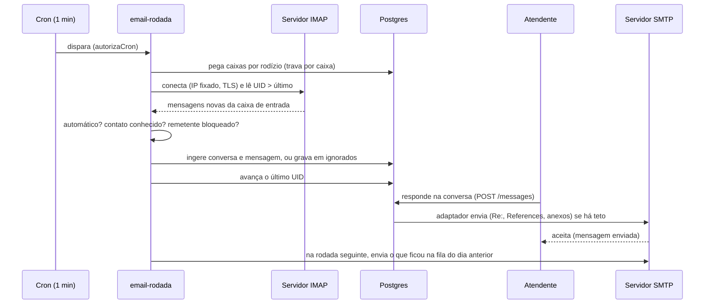

# Design: Canal de e-mail (IMAP/SMTP)

> Mudança `005-canal-de-e-mail-imap-smtp` · porte L · 2026-10-27
> O COMO. Respeita `.sdd/constitution.md` e os padrões que já existem no código.
> Seção que não se aplica: escreva "N/A — motivo".

## Abordagem

O e-mail entra como **mais um provider de canal** (`email`), seguindo o molde de `meta_cloud`/`zernio`/`datafy`: uma linha em `channel_sessions` (a "caixa"), um adaptador de envio, um ingestor de entrada e uma entrada na matriz de capacidades. A diferença é que **não há webhook**: a entrada é uma rodada periódica que lê a caixa por IMAP.

Fatos do código que moldam a solução:
- `channel_sessions` já carrega colunas por provider e dois CHECKs (`channel_sessions_provider_check`, `channel_sessions_provider_ref_check`) que precisam aceitar `email`; o molde é a migration `0387_canal_datafy`. `webhook_secret_encrypted` é NOT NULL, então a caixa grava um valor aleatório sem uso.
- `conversations.channel` aceita só `whatsapp`, `instagram`, `facebook`; precisa de `email` (e `CANAIS_DE_CONVERSA` em TypeScript anda junto, vigiado por `vocabulario-banco-x-typescript`). A RPC `fn_upsert_wa_conversation` grava `whatsapp` fixo, então o e-mail ganha a sua.
- Já existe `unique (organization_id, external_id)` em `messages`: o `Message-ID` do e-mail serve de `external_id` e o `23505` vira "duplicado" (AC-002.5).
- O envio é síncrono em `sendMessageHandler`, que escolhe o adaptador pelo provider da sessão; o motor de IA usa o mesmo handler. Assim, uma caixa com agente publicado funciona sem mexer no motor.
- O padrão dominante para trabalho periódico é **cron HTTP** (`app/api/v1/cron/<nome>/route.ts` + linha em `docker/scheduler/entrypoint.sh`, guardado por `autorizaCron`), com rodízio e prazo (`contact-names`, `channel-health`).
- Não há biblioteca IMAP, parser MIME nem sanitizador de HTML no projeto. O `nodemailer` já existe e serve ao envio.
- A proteção anti-SSRF existente (`validarHostDeBanco`) **permite endereços de rede local (RFC1918)**; para e-mail isso não serve.

Solução, em seis peças (todo o código do canal em `lib/channels/email/`, não em `lib/canais/email`, porque `lint:channels` proíbe nomear provider fora de `lib/channels/`; isto corrige o local dito na D-09 do Grill):
1. **Caixa = `channel_sessions` com `provider = 'email'`**, config sem senha, senha cifrada, estado de sincronização em tabela própria.
2. **Rodada de leitura** (cron de 1 minuto): rodízio entre caixas, prazo, lê só o que passou do último UID, filtra automáticos, ingere.
3. **Adaptador de envio** (nodemailer): `Re:`, `In-Reply-To`/`References`, citação, anexos, assinatura, teto diário e intervalo.
4. **Matriz de capacidades** com três capacidades novas que impedem lote, abordagem fria e IA sem aprovação.
5. **Destino seguro**: host e porta validados e IP resolvido fixado na conexão.
6. **Assistente de conexão** em `/app/connections` (aba nova) com teste real.

Alternativas descartadas:
- **Laço contínuo no worker (`runXxxLoop`):** o Grill dizia "worker", mas o padrão do projeto para rodadas periódicas é o cron HTTP, com cerca de teste que obriga a agendar a rota. O efeito é o mesmo (rodada de 1 minuto) e herda guarda, auditoria e testes. Fica o laço para um eventual IDLE.
- **Uma conversa por assunto:** o modelo tem uma conversa por contato e caixa (`uniq_conversations_1to1_per_contact_session`) e nenhum campo de assunto. Mudar isso quebraria fluxos que presumem uma conversa por contato (ADR-002).
- **Tabela de conta de e-mail separada de `channel_sessions`:** duplicaria estado e quebraria saúde, desligar-da-organização e a matriz.
- **Guardar o corpo dos ignorados:** engorda o banco e guarda dado pessoal sem necessidade; guardamos só o cabeçalho e relemos pelo UID se a pessoa promover.

## Componentes afetados

Novos (`lib/channels/email/`):
- `destino-seguro.ts`: valida host e porta (143, 993, 465, 587), resolve DNS, recusa qualquer IP especial **inclusive RFC1918**, devolve o IP a fixar com o `servername` original.
- `conexao.ts`: abre IMAP (`imapflow`) e SMTP (`nodemailer`) com TLS verificado e IP fixado; mensagens de falha em português a partir de `lib/net/alcance.ts`.
- `rodada.ts`: uma rodada de leitura por caixa (UIDVALIDITY, último UID, teto de mensagens, prazo).
- `parse.ts`: MIME (`mailparser`), texto, anexos com limite, `Message-ID`, `In-Reply-To`, `References`, assunto.
- `html-seguro.ts`: sanitização no ingestor (`sanitize-html`): sem script, formulário, iframe, estilo ou imagem remota; guarda texto e HTML limpo.
- `automatico.ts`: regra pura que decide "automático" (`List-Unsubscribe`, `Precedence: bulk|list|junk`, `Auto-Submitted`, `no-reply`, bounce) com o motivo.
- `ingest.ts`: acha ou cria contato por e-mail, RPC da conversa, INSERT em `messages`, `marcarConversaComMensagem`, `aplicarEfeitosPosEntrada` (molde `ingestMetaInbound`).
- `adapter.ts`: `ChannelAdapter` do e-mail (resolveRecipient por e-mail, send via SMTP, health).
- `limite.ts`: teto diário no fuso da organização, intervalo mínimo, fila para o dia seguinte.
- `segredo.ts`: cifra e decifra com `encryptWebhookSecret`/`decryptWebhookSecret`, `last4` em claro na config.

Novos (rotas e telas):
- `app/api/v1/cron/email-rodada/route.ts` (leitura + drenagem da fila de envio) e linha `* * * * *|50|api/v1/cron/email-rodada` no `docker/scheduler/entrypoint.sh`.
- `app/api/v1/channels/email/route.ts` (listar, conectar), `.../email/testar/route.ts`, `.../email/[id]/route.ts` (pausar, retomar, assinatura, teto), `.../email/ignorados/route.ts` (listar, promover) e `.../email/remetentes/route.ts` (marcar "não é cliente"). Todas admin, Zod, `requireSupportWrite(` antes do efeito nas mutações, `audit()`.
- `components/connections/CanalEmailClient.tsx` e `components/connections/email/AssistenteDeConexao.tsx` (não há stepper reutilizável hoje; este nasce simples para o subprojeto 6 reaproveitar), nova aba em `ConexoesShell.tsx`.

Alterados (extensão mínima):
- `lib/channels/types.ts` (`ChannelProvider`, `ProviderDeMensagem`, `RecipientInput.email`, `OutboundEnvelope` com `assunto`, `inReplyTo`, `references`, `anexos` opcionais, três capacidades), `capabilities.ts`, `index.ts` (ADAPTERS), `session-ref.ts`, `presentation.ts`, `canais-de-conversa.ts`, `inbound.ts` (e-mail não recebe webhook), `health.ts`.
- `app/api/v1/messages/_handler.ts`: lê o e-mail do contato, monta o envelope, consulta `adapter.admitir?` (teto/intervalo) antes de enviar e, se adiado, grava `queued` com a hora de retomada.
- `components/inbox/ChannelLogo.tsx` e `ConversationHeader/ListItem` (ícone de e-mail), `MessageBubble.tsx` (assunto no cabeçalho do balão, HTML limpo sob demanda) e `Composer.tsx` (sem áudio quando o canal não suporta).
- Campanhas, follow-up e `PainelIniciarConversa`/`conversa-nova.ts`: consomem as capacidades novas para recusar e-mail.
- `lib/agent-engine/guardrails/before-send.ts`: canal com `iaSoComAprovacao` só envia pelo fluxo `approved_reply`.
- `lib/env.ts` e `.env.example`: `EMAIL_CANAL` (`ligado` por padrão; `desligado` para a rodada e o envio).
- `package.json`: `imapflow`, `mailparser`, `sanitize-html` (versões fixas, escolhidas por maturidade e licença permissiva, conferidas na tarefa).

## Fluxo



## Contratos e interfaces

Adaptador (acréscimos opcionais ao contrato de canal):
```ts
interface ChannelAdapter {
  // ... existentes
  admitir?(s: { sessionRef: string; agora: Date }): Promise<{ ok: true } | { ok: false; adiarAte: Date; motivo: "teto_diario" | "intervalo" }>;
}
interface OutboundEnvelope { /* ... */ assunto?: string; inReplyTo?: string; references?: string[]; anexos?: AnexoDeEmail[]; }
interface RecipientInput { /* ... */ email?: string; }
```

Capacidades novas em `ChannelCapabilities` (todas obrigatórias, cada uma com consumidor real, exigido pelo teste de matriz):
| Capacidade | E-mail | Demais | Consumidor |
|---|---|---|---|
| `envioEmLote` | `false` | `true` | campanhas e follow-up em lote (AC-005.4) |
| `iniciaConversa` | `false` | `true` | `PainelIniciarConversa` e `conversa-nova.ts` (AC-004.6) |
| `iaSoComAprovacao` | `true` | `false` | `before-send.ts` (AC-004.5) |

Perfil do e-mail na matriz: `banRisk: false`, `requiresTemplates: false`, `freeformOutsideWindow: true`, `groups: "none"`, `minIntervalMs: null` (o intervalo e o teto são do `limite.ts`, por caixa), `voiceNote`: valor neutro sem consumidor, `phonebook: false`.

Erros canônicos novos em `lib/api/errors.ts`: `email_conexao_recusada`, `email_destino_proibido`, `email_teto_diario`, `email_so_responde`, `email_envio_em_lote`. Auditoria nova: `channel.email_connected`, `channel.email_paused`, `channel.email_resumed`, `channel.email_sender_blocked`, `channel.email_ignored_promoted`.

Rotas (todas `ok()`/`fail()`, Zod, `X-Request-Id`):
| Rota | Quem | Efeito |
|---|---|---|
| `POST /api/v1/channels/email/testar` | admin | entra na caixa e envia o e-mail de teste; devolve causa clara ou `ok` |
| `POST /api/v1/channels/email` | admin | cria a caixa (após teste), cifra a senha, nada importado |
| `PATCH /api/v1/channels/email/[id]` | admin | pausar, retomar, assinatura, teto, intervalo, trocar senha |
| `GET /api/v1/channels/email/ignorados` | admin | lista cabeçalhos ignorados com o motivo |
| `POST /api/v1/channels/email/ignorados/[id]/promover` | admin | relê pelo UID e ingere como conversa |
| `POST /api/v1/channels/email/remetentes` | agent+ | marca "não é cliente" |
| `GET /api/v1/cron/email-rodada` | cron | rodada de leitura e drenagem da fila |

## Modelo de dados

Migrations aditivas, idempotentes, com apêndice no `baseline.sql` antes da varredura anon (número a confirmar com `pnpm checar:colisao-de-migration`). Padrão drop+add dos CHECKs, como na 0387:

1. `channel_sessions`: aceita `provider = 'email'` nos dois CHECKs; colunas `email_address text`, `email_config jsonb` (hosts, portas, segurança, usuário, últimos 4 da senha, assinatura, teto, intervalo; sem senha), `email_password_encrypted text`; índice único parcial por `(organization_id, email_address)` entre ativas. `webhook_events_log_provider_check` ampliado onde preciso.
2. `conversations_channel_check` aceita `email`; `fn_upsert_email_conversation` (security definer) com `revoke execute ... from public, anon` e grant só a `service_role`.
3. `email_sync_estado (channel_session_id pk, uidvalidity, ultimo_uid, ultima_rodada_em, travado_ate, falhas_seguidas, pausa_motivo)`: estado mutável e frequente fora da linha da sessão; `travado_ate` serve de trava por compare-and-swap.
4. `email_ignorados (id, organization_id, channel_session_id, message_id, uid, remetente, assunto, recebido_em, motivo)` com `unique (organization_id, channel_session_id, message_id)`; só cabeçalho; poda por retenção (30 dias) no cron `data-retention`.
5. `email_remetentes_ignorados (organization_id, endereco_normalizado)` único; a regra "não é cliente".
6. `email_envios_dia (channel_session_id, dia, quantidade)`, único em `(channel_session_id, dia)`, para o teto no fuso da organização.
7. Vocabulário: `agent_inbox_items.kind` ganha `email_senha_recusada` e `email_teto_atingido` (migration + `vocabulario.ts` no mesmo commit, vigiado pelo invariante).

RLS: todas as tabelas novas com RLS por organização (leitura para admin, escrita só `service_role`); a senha nunca é coluna legível ao cliente.

## Decisões (ADRs)

### ADR-001: Rodada por cron HTTP em vez de laço contínuo no worker
- Contexto: o Grill pediu "o worker faz a consulta de 1 minuto". O código tem os dois estilos, e o dominante para jobs periódicos é o cron HTTP com cerca que obriga o agendamento.
- Decisão: `app/api/v1/cron/email-rodada` a cada minuto, com rodízio, prazo de 45 s e trava por caixa. Conexões são curtas (abre, lê, fecha).
- Consequências: herda guarda, auditoria e testes; sem conexão aberta por organização (D-02 do Grill mantida); se um dia houver IDLE, ele vira um laço no worker sem mudar o resto.

### ADR-002: Uma conversa por contato e caixa; o assunto vive na mensagem
- Contexto: o modelo tem uma conversa por contato e sessão e nenhum campo de assunto; fluxos como pós-entrada e IA presumem isso.
- Decisão: manter a unicidade; o assunto e os cabeçalhos de encadeamento ficam em `messages.metadata`; as respostas usam o `Message-ID` da última mensagem recebida para `In-Reply-To` e `References`.
- Consequências: AC-002.4 vale por construção (a resposta cai na conversa do contato); dois assuntos diferentes do mesmo contato convivem na mesma conversa, com o assunto no balão. Aceitável para autônomos; "um assunto por conversa" fica fora de escopo.

### ADR-003: Destino seguro mais estrito que o de banco externo
- Contexto: host e porta vêm da pessoa, e o `validarHostDeBanco` aceita rede local.
- Decisão: `destino-seguro.ts` recusa qualquer IP especial (loopback, link-local, metadata, RFC1918, CGNAT, multicast), restringe portas e **fixa o IP resolvido** na conexão com o `servername` original, fechando a janela de DNS rebinding que o helper atual declara.
- Consequências: instalação que queira IMAP em rede interna não é atendida (aceito); o teste cobre cada classe de IP e o rebinding.

### ADR-004: Três capacidades novas em vez de perguntar "é e-mail?"
- Contexto: a doutrina de restrição de canal proíbe feature que pergunte o provider; capacidade sem consumidor reprova.
- Decisão: `envioEmLote`, `iniciaConversa` e `iaSoComAprovacao`, cada uma com consumidor real.
- Consequências: o teste de matriz e a lista de capacidades do teste mudam (campos novos); os outros canais assumem o valor atual de comportamento.

### ADR-005: Senha cifrada pelo mecanismo já usado por SMTP e canais
- Contexto: há dois mecanismos; o das credenciais de canal e do SMTP da instalação usa `fn_encrypt_oauth`/`encryptWebhookSecret`.
- Decisão: reaproveitá-lo para a senha da caixa; guardar os últimos 4 em `email_config`; decifrar só no servidor, só dentro de `conexao.ts`.
- Consequências: sem chave nova; a senha nunca volta a tela, API, log, auditoria ou Sentry, com teste que varre as respostas e o log.

### ADR-006: Higienizar o HTML na entrada
- Contexto: não há sanitizador no projeto, e o balão do inbox renderiza texto.
- Decisão: sanitizar no ingestor com lista de tags e atributos permitidos, sem imagem remota nem estilo; o inbox mostra texto por padrão e o HTML limpo sob demanda.
- Consequências: nova dependência pinada; o que foi gravado já está seguro, mesmo se o renderizador mudar.

## Riscos e casos extremos

- **V-6 (senha de app):** a sonda é a primeira tarefa; falhou ⇒ volta ao design (outros provedores ou auditoria do Gmail).
- **Bloqueio da conta do cliente:** pausa no primeiro erro de senha (sem nova tentativa), `falhas_seguidas` com recuo, teto diário e intervalo no envio.
- **Rodadas sobrepostas:** `travado_ate` por compare-and-swap; segunda rodada pula a caixa.
- **UIDVALIDITY mudou:** o cursor é descartado e relido a partir de "agora" sem importar o passado; o `unique` do `Message-ID` evita duplicata.
- **Eco do enviado:** só lemos a caixa de entrada, então o e-mail enviado não volta; o `Message-ID` que geramos é o `external_id`.
- **E-mail gigante, anexo enorme, codificação estranha:** limite de tamanho por mensagem, prazo por mensagem, falha de uma não derruba a rodada, registro do motivo.
- **Envio adiado:** o handler grava `queued` com `adiar_ate`; a rodada drena a fila quando há teto, para pessoa e para IA (a IA só gera rascunho, então o envio só ocorre após aprovação).
- **Pré-liberação do canal (`decidirPreGoLiveDoCanalViaSupabase`) pede telefone:** tarefa específica para o e-mail não ser barrado por isso; teste de regressão para o WhatsApp.
- **Muitos fluxos presumem telefone** (duplicidade, `contact-phones`, pós-entrada): levantados em tarefa de varredura, com teste.
- **Switches por provider espalhados:** `ADAPTERS`, `session-ref`, `presentation`, `health`, `desligar-da-organizacao`, `selectable`, `templates-fonte`; `pnpm lint:channels` e o teste de matriz vigiam. Nome de provider fora de `lib/channels/` reprova.
- **Segurança:** TLS verificado; senha só no servidor; HTML higienizado; destino seguro com IP fixado; mutações com `requireSupportWrite(` e auditoria; RLS entre duas organizações testada.
- **Rollback (< 2 min):** `EMAIL_CANAL=desligado` ou pausar a caixa; migrations só aditivas; imagem anterior pelo `deploy.sh`; nada é apagado.

## Estratégia de testes

Camada mais baixa que prova cada critério; testes citam o ID (`it('AC-002.1: ...')`). Neste PC só `vitest <um arquivo>`; o resto no CI.

| Critérios | Camada | Onde |
|---|---|---|
| AC-001.1, 001.2 | Componente do assistente (Gmail pré-preenchido, passos, genérico) | `components/connections/email/AssistenteDeConexao.test.tsx` |
| AC-001.3, 001.4 | Unitário de `conexao.ts` com servidores simulados (sucesso, senha recusada, DNS, porta, 2FA) | `lib/channels/email/conexao.test.ts` |
| AC-001.5, 001.6, 007.5 | Unitário das rotas (Zod, papel, `requireSupportWrite(`, auditoria) | `tests/unit/email-rotas.test.ts` |
| AC-002.1 a 002.4 | Unitário do ingestor com servidor IMAP simulado e banco em memória do projeto | `lib/channels/email/ingest.test.ts` |
| AC-002.5, 002.6, 006.2 | Invariante com Postgres real (`unique`, cursor, UIDVALIDITY) | `tests/invariants/email-idempotencia.test.ts` |
| AC-003.1 a 003.5 | Unitário puro da regra de automático e do fluxo de ignorados/promover | `lib/channels/email/automatico.test.ts`, `email-ignorados.test.ts` |
| AC-004.1 a 004.4 | Unitário do adaptador (cabeçalhos, citação, anexos, limite) com SMTP simulado | `lib/channels/email/adapter.test.ts` |
| AC-004.5, 004.6, 005.4, 008.4 | Teste de matriz (capacidades e consumidores) e guardrail | `tests/unit/channel-capability-matrix.test.ts`, `before-send` |
| AC-005.1 a 005.3 | Unitário de `limite.ts` com relógio injetado e fuso | `lib/channels/email/limite.test.ts` |
| AC-006.1, 006.3 a 006.5 | Unitário da rodada (senha recusada pausa, malformado pulado, prazo, falha de envio) | `lib/channels/email/rodada.test.ts` |
| AC-007.1 a 007.3 | Unitário que varre resposta e log; HTML malicioso sanitizado | `lib/channels/email/segredo.test.ts`, `html-seguro.test.ts` |
| AC-007.4, 009.2 | Invariante de RLS e grants entre duas organizações | `tests/invariants/email-isolamento.test.ts` |
| AC-008.1, 008.2, 008.5 | Componente do inbox e da aba de Canais, pausa sem perda | `components/inbox/*.test.tsx`, `CanalEmailClient.test.tsx` |
| AC-008.3, 009.4 | Unitário da chave de desligamento e sonda de produção | `lib/channels/email/rodada.test.ts`, `tests/infra/vps/sondas.sh` |
| AC-009.1 | Sonda real com Gmail (senha de app) e outro provedor, evidência gravada | `docs/solucao-crm/evidencias/005-email/` |
| AC-009.3 | Jornada pela tela na homologação com servidor de e-mail real | `tests/e2e/email.spec.ts` (fora do CI até rodada manual) |
| AC-009.5 | Dicionário en/es e cerca de marca | `tests/unit/branding.test.ts` e teste de dicionário |
