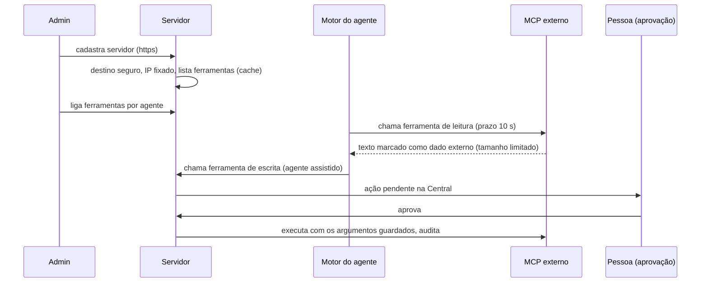

# Design: Agente de IA: provedores, ferramentas e MCP

> Mudança `006-agenda-lembretes-ferramentas-do-agente-mcp-e-openrouter` · porte L · 2026-10-27
> O COMO. Respeita `.sdd/constitution.md` e os padrões que já existem no código.
> Seção que não se aplica: escreva "N/A — motivo".

## Correções ao PRD (verificadas no código depois da aprovação)

O PRD afirmou que OpenRouter e compatíveis "não existem"; **isso estava errado**. Ele leu o CHECK antigo do `baseline.sql`; o apêndice (migration 0127) já removeu esse CHECK, e a migration 0413 criou `ai_provider_credentials.base_url`. Hoje existem `anthropic`, `openai`, `openai-assinatura`, `google`, **`openrouter`**, `deepseek`, `requesty` e **`custom`** (endereço próprio) em `lib/ai/pontos/provedores.ts`, instanciados em `lib/ai/runtime/agent.ts` (`buildModel`) e `lib/agent-engine/edge/llm/providers.ts`, com tela (`app/app/ai/credentials`, `AddCredentialDialog`), teste de chave (`credentials/test`) e catálogo de modelos da OpenRouter sincronizado por cron.

Consequências para os critérios:
- **REQ-001** vira, em sua maior parte, **teste de caracterização**: o código já cumpre AC-001.1 a AC-001.5. O trabalho novo é AC-001.6 (aviso de modelo fraco) e AC-001.7 (falha do provedor leva a conversa a um humano, com motivo próprio).
- **REQ-002** é real: o `custom` aceita `http://` e **nenhum helper fixa o IP resolvido** (há janela de DNS rebinding declarada em `outbound-ip.ts`).
- **REQ-004:** o teto existe (`ai_budgets`, padrão US$ 50) mas **nasce desligado** (`enforcement_mode = 'off'`), e modelo sem preço conhecido custa 0, então o teto não dispara.
- **REQ-003:** o modo assistido existe (`operation_mode = 'assisted'`), mas o **padrão é `automatic`** e a troca não pede confirmação.
- **REQ-005:** `request_human_handoff` e os gatilhos atuais existem; **não há contagem de erros de ferramenta**.
- **REQ-006:** não existe a ferramenta "criar tarefa".
- **REQ-007:** o MCP externo é **um servidor por organização** e hoje só o administrador da plataforma cadastra (cerca `cadastro-do-mcp-externo-e-o-platform-admin`).

As demais decisões do Grill seguem de pé.

## Abordagem

O trabalho se divide em seis frentes pequenas sobre o motor existente, sem reescrevê-lo:
1. **Destino seguro compartilhado** (`lib/net/destino-seguro.ts`): resolve o DNS, recusa qualquer IP especial, exige `https`, **fixa o IP** na conexão e não segue redirecionamento; usado pelo provedor `custom`, pelo MCP externo e, quando for implementado, pelo canal de e-mail (mudança 005, que desenhou o seu próprio; ver Riscos).
2. **Modos do agente:** padrão `assisted` para agentes novos e confirmação explícita, no servidor e na tela, para ir ao automático.
3. **Teto de custo que realmente protege:** orçamento armado por padrão em organizações novas, preço estimado conservador para modelo sem preço, aviso por e-mail em 80%, tokens por agente na tela.
4. **Falhas de provedor e de ferramenta levam a um humano:** dois motivos novos de transferência e um contador de erros seguidos por conversa.
5. **Ferramentas:** conferência por teste de caracterização, mais a ferramenta nova `crm_create_task`.
6. **MCP externo com vários servidores:** tabela própria, migração do servidor atual, ferramentas ligadas por agente, escrita com aprovação, retorno marcado como dado externo com tamanho e prazo máximos.

Alternativas descartadas:
- **Criar adaptador novo de provedor:** duplicaria o que existe (risco nº 1 do mapa).
- **Reescrever o modo do agente com uma coluna "ligado":** "no ar" já é derivado de `published_version_id`, `paused_at` e `archived_at` (`no-ar.ts`); só o padrão e a confirmação mudam.
- **Cobrar preço pelo catálogo apenas:** modelo `custom` sem linha em `ai_models` continuaria custando 0.
- **Executar ferramenta de escrita do MCP durante o rascunho:** viola a aprovação; ver ADR-005.

## Componentes afetados

Novos:
- `lib/net/destino-seguro.ts` (`resolverDestinoSeguro`, `fetchComIpFixado`); testes por classe de IP, redirecionamento e rebinding.
- `lib/ai/orcamento/preco-estimado.ts`: preço conservador por milhão de tokens para modelo sem preço, devolvendo `estimado: true`.
- `lib/ai/handoff/falhas-de-ferramenta.ts`: contador de erros seguidos por conversa, com reinício a cada sucesso.
- `lib/mcp/tools/tarefas.ts` (`crm_create_task`, com `idempotencyKey`).
- `lib/mcp/servidor-externo/repositorio.ts` (vários servidores), `aprovacao.ts` (ações de escrita pendentes), `resultado-como-dado.ts` (embrulho de entrada não confiável, reaproveitando o de `lib/mcp/tools/dados-externos.ts`).
- `app/api/v1/ai/agents/[id]/automatico/route.ts` (confirmação do modo automático), `app/api/v1/mcp-servidores/**` (CRUD, listar ferramentas, aprovar ação pendente), componentes em `app/app/settings/servidor-mcp-externo/` e `app/app/ai/agents/[id]/_components/`.

Alterados (extensão mínima):
- `lib/ai/runtime/agent.ts`, `lib/agent-engine/edge/llm/providers.ts` e `lib/automation/destinos-internos-autorizados.ts`: o `custom` passa a usar `lib/net/destino-seguro.ts` e a exigir `https` (um destino interno continua possível só pelo mecanismo existente de destinos autorizados, declarado pela plataforma).
- `app/api/v1/ai/agents/[id]/route.ts` e `AgentOperation.tsx`: trocar para automático exige o corpo `confirmar_automatico: true` e abre o diálogo de confirmação; audita `ai_agent.automatic_confirmed`.
- `app/actions/onboarding/createDefaultAgent.ts` e `lib/ai/agents/first-publication.ts`: o primeiro agente publicado nasce em `assisted`.
- `lib/agent-engine/edge/llm/run-model-call.ts`: aplica o contador de erros de ferramenta (`stopWhen`) e o preço estimado; mantém o gate do orçamento.
- `lib/ai/handoff/orchestrator.ts` (`HandoffReason`: `erro_de_ferramenta`, `provedor_indisponivel`), `lib/escalacao/passagem.ts` (`MOTIVOS_DA_PASSAGEM`), `agent-inbox-copy.ts`.
- `lib/ai/runtime/tools.ts`, `lib/mcp/servidor-externo/{carregar,chamada,ids,registro,segredo}.ts` e `lib/mcp/tools/externo.ts`: vários servidores, ids novos, prazo de 10 s, limite de tamanho do corpo e do resultado, embrulho como dado externo.
- `lib/ai/agents/validation.ts` (`VALID_TOOL_IDS` aceita o id novo e continua aceitando o antigo).
- UI: aviso de modelo fraco no teste da chave (`credentials/test`), tokens e custo estimado por agente em `app/app/ai/usage`, banner "sem teto" para organizações antigas.

## Fluxo



## Contratos e interfaces

Destino seguro:
```ts
resolverDestinoSeguro(url: string): Promise<{ ok: true; ip: string; servername: string } | { ok: false; motivo: "http" | "ip_especial" | "dns_falhou" | "host_invalido" }>
fetchComIpFixado(url: string, init?: RequestInit): Promise<Response> // redirect: "manual"; recusa 3xx para destino não validado
```

Rotas novas (todas `ok()`/`fail()`, Zod, `X-Request-Id`, `requireSupportWrite(` nas mutações, `audit()`):
| Rota | Papel | Efeito |
|---|---|---|
| `POST /api/v1/ai/agents/[id]/automatico` | admin | confirma o modo automático (corpo `confirmar_automatico: true`), audita |
| `GET/POST /api/v1/mcp-servidores` | ver ADR-004 | listar e cadastrar servidor (testa e guarda a lista de ferramentas) |
| `PATCH/DELETE /api/v1/mcp-servidores/[id]` | idem | trocar credencial, desativar, remover |
| `POST /api/v1/mcp-servidores/[id]/atualizar-ferramentas` | idem | refaz a lista de ferramentas |
| `POST /api/v1/mcp-acoes/[id]` | gerente+ | aprovar ou recusar uma ação de escrita pendente |

Id de ferramenta: `mcp_externo:<servidor>:<leitura|escrita>:<nome>` (novo) e `mcp_externo:<leitura|escrita>:<nome>` (antigo, continua válido e aponta para o servidor migrado). Nome exposto ao modelo no formato novo: `<servidor>__<nome>`, o que elimina colisão entre servidores e com o catálogo; o formato antigo mantém o nome cru.

Erros canônicos novos: `ai_destino_proibido`, `ai_http_nao_permitido`, `ai_confirmacao_exigida`, `mcp_servidor_invalido`, `mcp_acao_pendente`. Auditoria nova: `ai_agent.automatic_confirmed`, `mcp.server_added`, `mcp.server_removed`, `mcp.action_approved`, `mcp.action_rejected`.

## Modelo de dados

Migrations aditivas, idempotentes, com apêndice no `baseline.sql` antes da varredura anon (número a confirmar com `pnpm checar:colisao-de-migration`):
1. `ai_agents.operation_mode`: `alter column set default 'assisted'`. Só agentes **novos** mudam; as linhas existentes ficam como estão.
2. `ai_budgets.enforcement_mode`: padrão `'bloquear'` para linhas **novas**; linhas existentes intactas. Um trigger leve cria o orçamento padrão (limite 5000) quando a organização publica o primeiro agente e não tem linha.
3. `mcp_servidores_externos (id, organization_id, slug, nome, endpoint, chave_encrypted, chave_iv, chave_tag, chave_last4, ferramentas jsonb, ferramentas_em, ativo, created_at)`, único em `(organization_id, slug)`; RLS por organização, escrita só `service_role`; migração idempotente que copia o servidor de `organizations.settings.mcp_externo` e as colunas cifradas para a linha `slug = 'padrao'`, **sem apagar nada** do formato antigo (leitura de reserva e rollback).
4. `mcp_acoes_pendentes (id, organization_id, agente_id, conversa_id, servidor_id, ferramenta, argumentos jsonb, estado, criado_em, decidido_por, decidido_em)` com RLS e `unique` por `(conversa_id, hash dos argumentos, ferramenta)` para não duplicar.
5. `ai_falhas_de_ferramenta (conversation_id pk, organization_id, seguidas int, ultima_em)`.
6. Vocabulário: `agent_inbox_items.kind` ganha `acao_mcp_pendente` e `ia_provedor_indisponivel` (migration + TypeScript no mesmo commit, vigiado por `vocabulario-banco-x-typescript`).
7. Funções novas com `revoke execute ... from public, anon`.

## Decisões (ADRs)

### ADR-001: Um helper de destino seguro com IP fixado, compartilhado
- Contexto: o `custom` aceita `http` e o MCP externo e o `custom` só validam o DNS antes (janela de rebinding); o canal de e-mail precisa do mesmo.
- Decisão: `lib/net/destino-seguro.ts`, com `https` obrigatório, recusa de todo IP especial, IP fixado na conexão e `redirect: "manual"`. Destino interno (por exemplo um Ollama na LAN) continua possível só pelo mecanismo existente de destinos autorizados, definido pela plataforma.
- Consequências: quem usa `custom` com `http://` hoje deixa de funcionar e recebe a mensagem clara; o e-mail (005) deve importar este núcleo em vez de duplicar. Para TCP (IMAP/SMTP) o pino é feito com o IP devolvido pelo mesmo resolvedor.

### ADR-002: Preço estimado para modelo sem preço, sempre sinalizado
- Contexto: modelo sem linha de preço custa 0 e o teto não dispara.
- Decisão: usar um preço conservador por milhão de tokens (valor padrão alto, configurável) quando não há preço, marcando o gasto como "estimado" na tela e no aviso. O teto passa a valer também para esses modelos.
- Consequências: o gasto mostrado pode superestimar; é preferível a não proteger. Nunca se inventa um preço "real".

### ADR-003: Padrão `assisted` só para agentes novos; confirmação no servidor
- Contexto: o padrão `automatic` está no schema, no onboarding e em fluxos de prospecção.
- Decisão: mudar o padrão da coluna e do onboarding; exigir `confirmar_automatico: true` no servidor (a tela abre o diálogo, mas a regra não depende dela). Agentes existentes não mudam. A prospecção segue forçando `automatic` por ser outro fluxo (campanha explícita); isso é declarado e coberto por teste, não escondido.
- Consequências: ninguém é surpreendido na produção atual; novos agentes passam por revisão humana até a confirmação.

### ADR-004: Quem cadastra servidor MCP
- Contexto: hoje só o administrador da plataforma cadastra (cerca de teste), o que impede o autônomo de usar o próprio sistema externo; o Grill pediu "admin".
- Decisão: abrir o cadastro ao **administrador da organização**, condicionado a ADR-001 estar implantado (destino seguro, `https`, tamanho, prazo), com a chave de instalação `MCP_EXTERNO_ADMIN_DA_ORG` (padrão `desligado`) para a plataforma liberar. A cerca de teste é atualizada para o novo contrato. **Esta decisão afeta a postura de segurança e precisa da confirmação do dono antes de implementar.**
- Consequências: até a chave ser ligada, o comportamento de hoje fica intacto; ligada, o admin da organização cadastra sob as novas proteções.

### ADR-005: Ferramenta de escrita externa vira ação pendente no modo assistido
- Contexto: no modo assistido o agente redige e uma pessoa aprova a resposta, mas ferramentas poderiam executar durante o rascunho.
- Decisão: no modo `assisted`, uma ferramenta externa de escrita (ou sem o aviso `readOnlyHint`) não executa: devolve ao modelo "pendente de aprovação", grava uma ação pendente e abre um item na Central; ao aprovar, o servidor executa com os argumentos guardados e audita. No `automatic`, só roda sem aprovação se o admin marcou "pode rodar sem aprovação" para a ferramenta.
- Consequências: o agente precisa lidar com "pendente" na conversa; leitura continua imediata.

### ADR-006: Retorno de MCP como dado externo, com limites
- Contexto: o resultado volta ao modelo sem marca e sem limite de tamanho.
- Decisão: embrulhar o texto como entrada não confiável (mesmo mecanismo de `dados-externos.ts`), cortar acima de um limite fixo e reduzir o prazo de 15 s para 10 s; o corpo é lido com limite, não inteiro.
- Consequências: respostas gigantes são truncadas com aviso; a injeção de instrução no retorno perde força, sem eliminar o risco (as outras camadas somam).

## Riscos e casos extremos

- **Reimplementar o que existe:** mitigação: a primeira tarefa de cada frente é um teste de caracterização; o PRD corrigido deixa claro o que é novo.
- **Invariantes que vigiam listas de provedores** (`provedores-x-registry`, `i18n-provedores-e-pontos`, `par-provedor-modelo`, `provedor-personalizado`, `painel-de-provedores-*`): não adicionamos provedor, então devem seguir verdes; rodam como piso.
- **Quem usa `custom` com `http://`:** deixa de funcionar; mensagem clara e caminho por destino autorizado. Verificar na produção atual (zero esperado).
- **Dois helpers de destino seguro (005 e 006):** o design do e-mail definiu o seu em `lib/channels/email/destino-seguro.ts`. Quem for implementado primeiro cria o núcleo em `lib/net/destino-seguro.ts`; o outro importa. Registrar na primeira tarefa de ambas. Sem isso, duas regras divergem.
- **Migração do MCP de um para vários servidores:** versões publicadas são imutáveis e guardam o id antigo; o formato antigo continua válido e mapeia para o servidor `padrao`. Teste de migração em banco com dados e teste de que o turno com id antigo funciona.
- **Latência de `tools/list` por turno:** a lista passa a ser guardada (`ferramentas_em`) e só refeita ao cadastrar, ao pedir ou após expirar (10 min).
- **Prospecção força `automatic`:** declarado e testado; revisar na tarefa se é aceitável (fluxo de campanha explícito).
- **Contador de erros de ferramenta:** reinicia a cada sucesso e por conversa; um modelo que erra sempre vai a humano no segundo erro, sem laço.
- **Preço estimado alto demais:** pode parar um agente cedo; o aviso em 80% e a tela mostram "estimado" e o admin ajusta o teto.
- **Segurança:** chave e credencial cifradas, nunca em log; `https` e IP fixado; ferramentas desligadas por padrão; escrita com aprovação; RLS entre duas organizações testada; `requireSupportWrite(` nas mutações.
- **Rollback (< 2 min):** `MCP_EXTERNO_ADMIN_DA_ORG` desligado e `MCP_SERVIDORES=legado` voltam ao servidor único; padrões novos valem só para linhas novas; migrations só aditivas; imagem anterior pelo `deploy.sh`.

## Estratégia de testes

Camada mais baixa que prova cada critério; testes citam o ID (`it('AC-001.1: ...')`). Neste PC só `vitest <um arquivo>`; o resto no CI. Onde o código já cumpre, o teste é de caracterização (documenta e fixa).

| Critérios | Camada | Onde |
|---|---|---|
| AC-001.1 a 001.5 | Caracterização do cadastro, teste, últimos 4 e uso no agente (já existem) | `app/app/ai/credentials/*.test.tsx`, `tests/unit/provedor-personalizado.test.ts` |
| AC-001.6, 001.7 | Unitário do aviso de modelo fraco e do motivo `provedor_indisponivel` | `lib/ai/provider-validators.test.ts`, `lib/ai/handoff/*.test.ts` |
| AC-002.1 a 002.4 | Unitário de `destino-seguro` (classes de IP, http, IP fixado, redirecionamento) | `lib/net/destino-seguro.test.ts` |
| AC-003.1 a 003.3, 003.7 | Caracterização do rascunho, aprovação e pausa + invariante do padrão novo | `tests/invariants/agente-nasce-assistido.test.ts` |
| AC-003.4 a 003.6 | Unitário da rota de confirmação (corpo exigido, papel, auditoria) e componente do diálogo | `tests/unit/agente-automatico-confirmacao.test.ts`, `AgentOperation.test.tsx` |
| AC-004.1 a 004.3, 004.5 | Invariante do orçamento padrão e unitário do gate, dos avisos e da virada de período | `tests/invariants/orcamento-armado-por-padrao.test.ts`, `orcamento-*.test.ts` |
| AC-004.4, 004.6 | Componente da tela de uso e unitário do preço estimado | `app/app/ai/usage/*.test.tsx`, `lib/ai/orcamento/preco-estimado.test.ts` |
| AC-005.1, 005.2, 005.4 | Caracterização do handoff existente | `lib/agent-engine/agent/human-handoff.test.ts` |
| AC-005.3 | Unitário do contador de erros seguidos e do motivo novo | `lib/ai/handoff/falhas-de-ferramenta.test.ts` |
| AC-006.1 a 006.3, 006.5, 006.6 | Caracterização das ferramentas + unitário de `crm_create_task` (idempotência, argumentos inválidos, organização) | `lib/mcp/tools/tarefas.test.ts`, `agendamento*.test.ts` |
| AC-006.4 | Caracterização da busca na base (fonte e organização) | `lib/mcp/tools/evolucao.test.ts` |
| AC-007.1, 007.2, 007.8, 007.9 | Unitário do repositório de servidores e da migração (banco com dados) | `lib/mcp/servidor-externo/repositorio.test.ts`, `tests/invariants/mcp-multi-servidor.test.ts` |
| AC-007.3, 007.4 | Unitário da ação pendente por modo e da aprovação | `lib/mcp/servidor-externo/aprovacao.test.ts` |
| AC-007.5 a 007.7 | Unitário do embrulho, do limite, do prazo e da auditoria sem credencial | `lib/mcp/servidor-externo/externo.test.ts` ampliado |
| AC-008.1 a 008.4 | Varredura de respostas e log, rotas (Zod, papel, `requireSupportWrite(`), invariante de isolamento entre organizações | `tests/unit/ai-segredos.test.ts`, `tests/invariants/mcp-nao-alcanca-outro-tenant.test.ts` |
| AC-009.1 | Sonda real (chave do OpenRouter e servidor MCP de teste), evidência gravada | `docs/solucao-crm/evidencias/006-agente/` |
| AC-009.2 | Invariantes de RLS, grants e CHECKs | `tests/invariants/` |
| AC-009.3 | Jornada pela tela na homologação com serviços reais | `tests/e2e/agente-ia.spec.ts` (fora do CI até rodada manual) |
| AC-009.4 | Sonda de produção | `tests/infra/vps/sondas.sh` |
| AC-009.5 | Dicionário en/es e cerca de marca | `tests/unit/branding.test.ts` e teste de dicionário |
